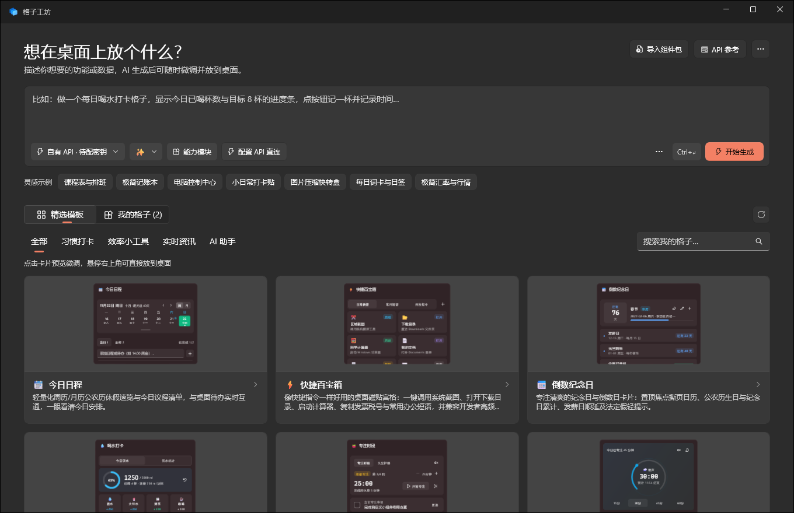
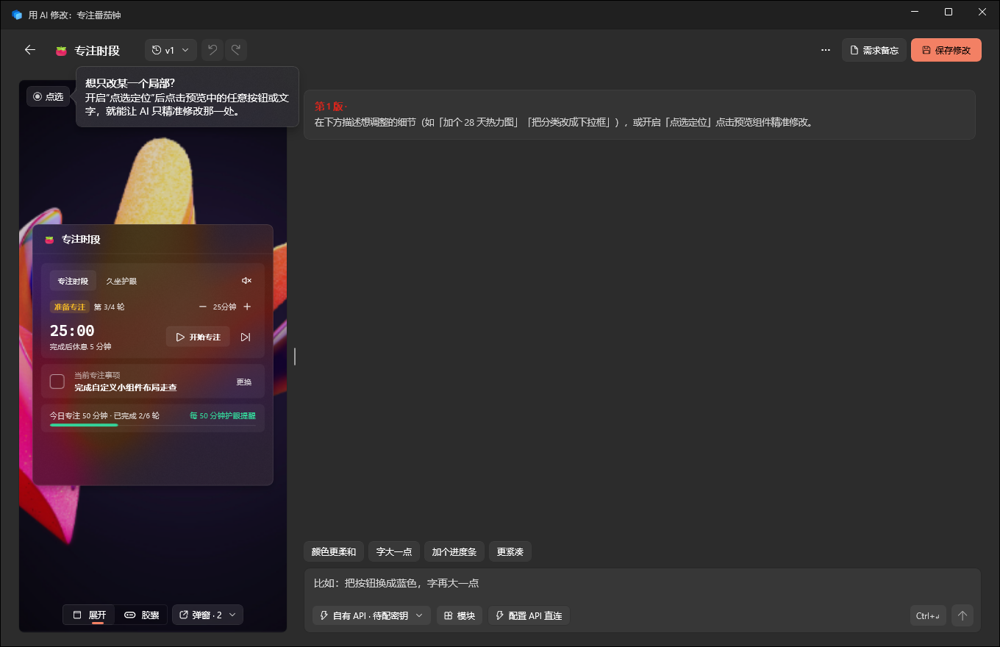
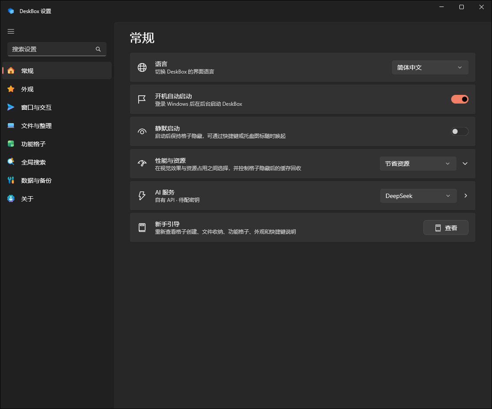
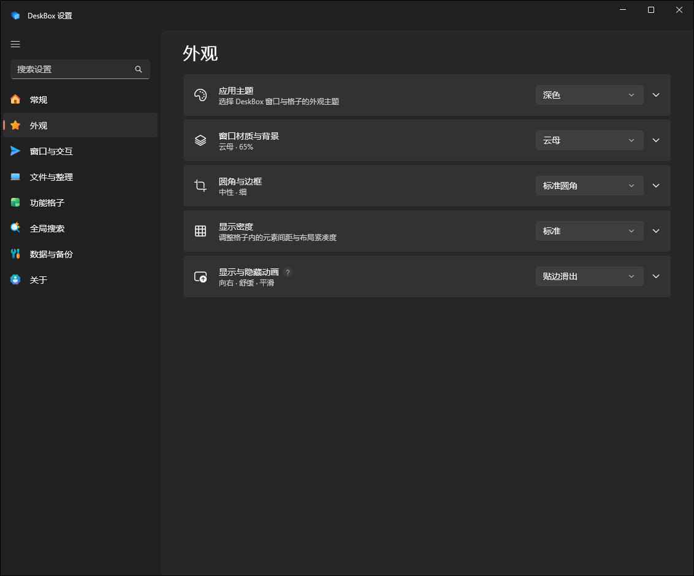
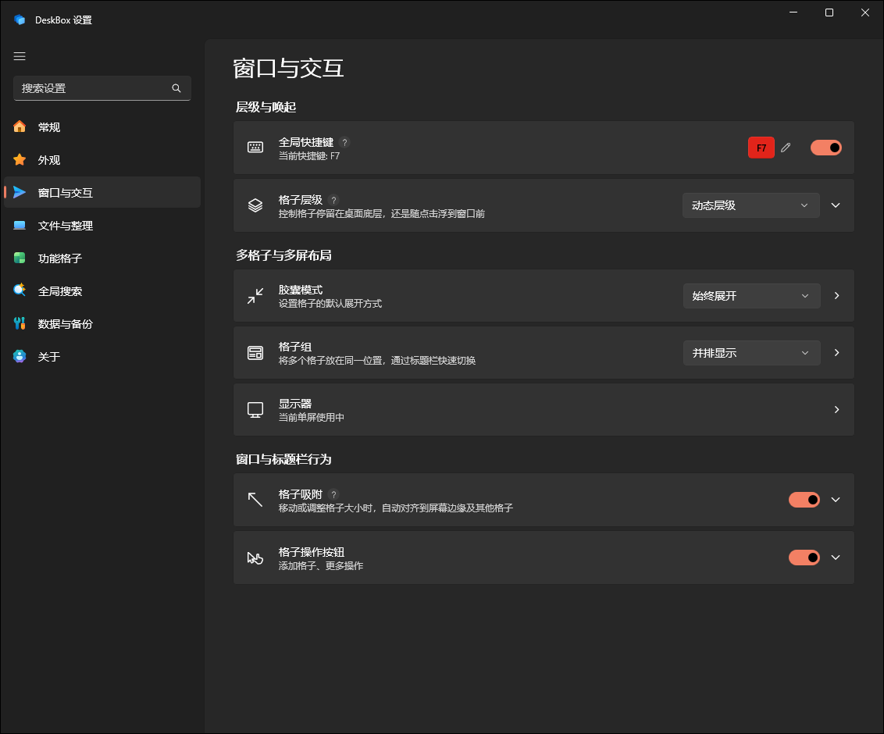
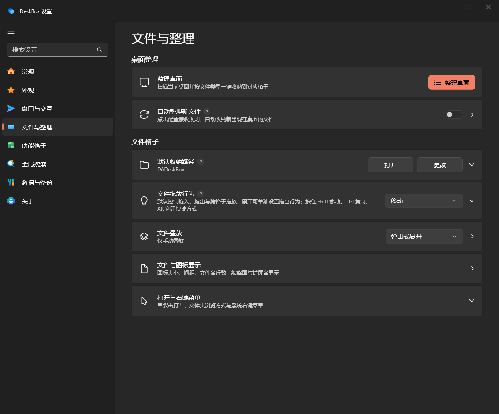
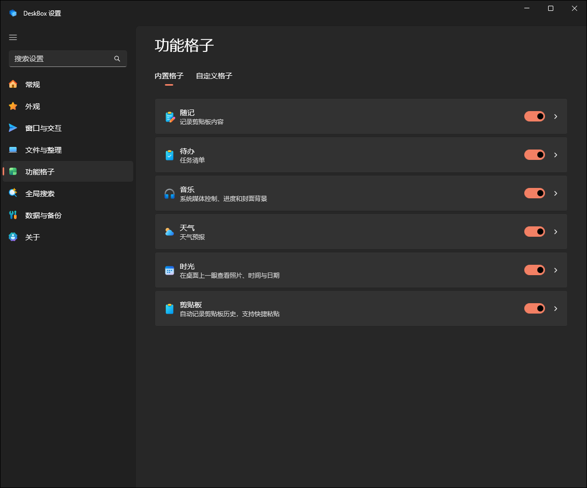
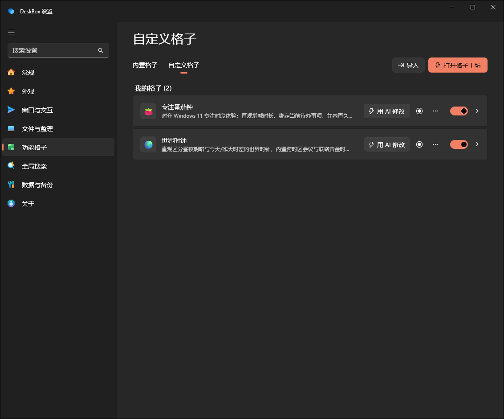
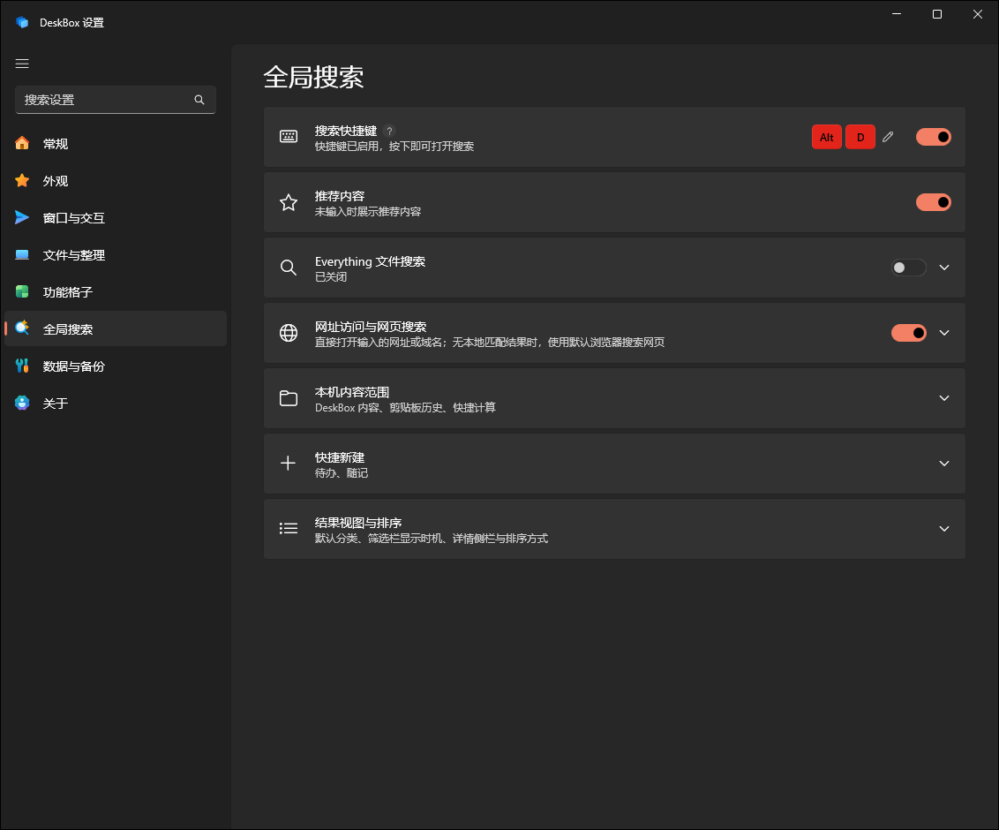
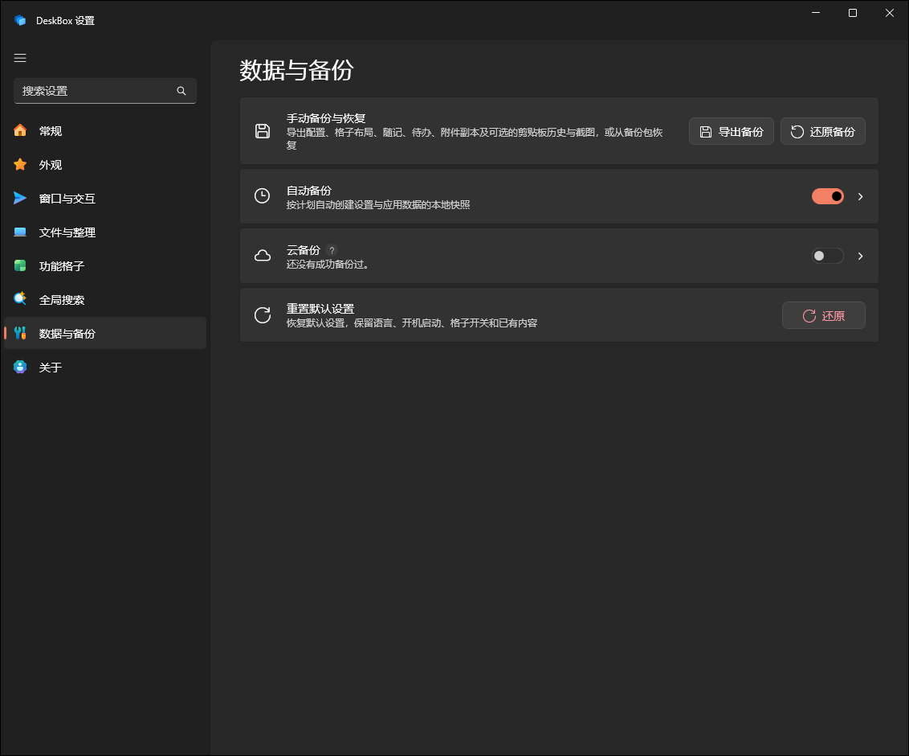

<div align="center">


# DeskBox

**开源、本地优先的 Windows 10/11 桌面整理工具，提供原生质感的 WinUI 3 格子与自定义组件生态。**

简体中文 | [English](README.md)

[下载与安装](#下载与安装) · [核心功能](#核心功能) · [界面预览](#界面与视觉体验) · [技术概览](#技术概览) · [从源码构建](#从源码构建) · [授权协议](LICENSING.md)

[](https://github.com/Tianyu199509/DeskBox/actions/workflows/ci.yml)
[](https://github.com/Tianyu199509/DeskBox/releases/latest)
[](#技术概览)
[](#下载与安装)
[](LICENSING.md)
[](https://github.com/Tianyu199509/DeskBox/stargazers)
[](https://github.com/Tianyu199509/DeskBox/releases)
<a href="https://hellogithub.com/repository/Tianyu199509/DeskBox" target="_blank"></a>

</div>

> **贡献状态说明：** 项目处于高频迭代与扩展解耦期，暂不接受外部 Pull Request 代码合并，欢迎通过 [GitHub Issues](https://github.com/Tianyu199509/DeskBox/issues) 或 Discussions 提交 Bug 反馈与功能建议，详见 [CONTRIBUTING.md](CONTRIBUTING.md)。


DeskBox 基于 C#、WinUI 3、.NET 10 Native AOT 与 Rust 原生层构建，在原生 Windows 桌面上增加一层轻盈的桌面格子，不替换系统资源管理器，也不改变文件原有的物理存储方式。以真实文件夹为基础的文件格子使它成为 Stardock Fences 等工具的现代开源替代；同时提供剪贴板历史、全局搜索弹窗、待办与随记、时光、天气、音乐控制以及可编程的自定义桌面组件。

---

## 下载与安装

| 分发渠道 | 适用版本与特点 | 获取地址 |
| --- | --- | --- |
| **GitHub Releases（官网直装版）** | `x64` / `ARM64` 离线安装包，Full Native AOT 构建，内置私有 Windows App Runtime 2.7，支持应用内静默更新与伴侣进程隔离 | [前往 GitHub Releases 最新版](https://github.com/Tianyu199509/DeskBox/releases/latest) |
| **官方网站** | 查看产品介绍、下载直装安装包与使用文档 | [deskbox.fun](https://deskbox.fun) |
| **Microsoft Store（商店付费版）** | 微软商店托管签名与自动更新，适合希望直接支持项目持续维护的用户 | [前往 Microsoft Store](https://apps.microsoft.com/store/detail/9PBZSNB4D69H) |

- **完整性校验**：GitHub Releases 每个安装包均附带同名 `.sha256` 校验文件，安装前可核对文件哈希；详情参阅[代码签名与校验策略](docs/code-signing.md)。
- **系统门槛**：支持 **Windows 10 2004（Build 19041）及以上** 与 **Windows 11（推荐 22H2+）**，原生支持 `x64` 与 `ARM64`（骁龙等 Windows on ARM 设备），支持标准系统目录安装或免提权当前用户安装，可完全离线安装。
- **版本发布记录**：完整版本演进与详细更新内容请参阅 [CHANGELOG.md](CHANGELOG.md)。

---

## 核心功能

### 1. 文件格子与桌面整理

- **真实文件夹映射与收纳**：创建由本地文件夹支撑的收纳格子，或直接把桌面、磁盘中的已有文件夹映射到桌面而不改变原文件位置；旧文件迁入托管存储采用“先复制、后校验、不自动删源”的稳妥流程。
- **Windows 11 原生级文件交互**：内嵌 Windows 11 样式单竖列右键菜单（含行内图标、「打开方式」真实关联应用、空白处「新建 / 查看 / 排序」与原生 ZIP 压缩/解压），支持按空格调用 [QuickLook](https://github.com/QL-Win/QuickLook) 预览。
- **多源拖拽与叠放管理**：完整支持资源管理器、微信及浏览器内容（含远程链接下载导入）拖入与拖出、手动排序、格子内子文件夹折叠弹窗（自适应 / 3×3 / 5×5），以及提权会话下的指针跟踪安全拖出。
- **全类型格子分组与桌面整理工作台**：任意类型格子均可无损合并为分组标签页（支持联通标签与等宽并列模式、`Ctrl+Tab` 与滚轮切换及亚克力合并/拆出落点预览）；桌面整理工作台支持按分类与扩展名规则预览分流、自动后台归档新落盘文件及历史操作回溯。

### 2. 日常效率与桌面组件

- **统一全局搜索弹窗（`Alt+D`）**：通过本地 IPC 直连已安装的 Everything 索引并与桌面格子、随记、待办、剪贴板历史、应用及设置合并检索（DeskBox 不维护重复索引，Everything 需单独安装）；内置即时计算器、命令面板、网页搜索兜底与推荐区编辑模式（应用文件夹分组与多选拖拽排序）。
- **剪贴板历史与全局快捷粘贴（`Alt+V`）**：自动采集文本、HTML/RTF 富文本、图片、文件与色值，支持 `Alt+V` 全局快捷粘贴弹窗、本机离线图片 OCR 检索、内置文本快捷转换、可选网页链接标题自动抓取、来源应用排除规则、大条目外置存储，以及敏感凭据的本机 DPAPI 静态加密与脱敏显示。
- **响应式待办与随记**：支持单/双栏自适应布局、中英文自然语言日期/时间/重复规则录入、全文检索、逾期一键顺延、待办与随记双向互转、提醒与颜色标记、随记独立置顶小窗、多条笔记合并，以及关联或托管附件的 Markdown 目录镜像同步。
- **时光、天气与音乐组件**：时光格子融合日期、农历与节气；天气内置 MSN 天气与 Open-Meteo 回退及 4 套内置图标风格；音乐组件接管 Windows 系统媒体会话，提供专辑氛围色、频谱动画与 LRCLIB / 本地 `.lrc` 同步滚动歌词。

### 3. 自定义格子与格子工坊（Widget Studio）

- **零 WebView 原生声明式引擎**：基于扁平元素图（`manifest.json`）渲染原生 WinUI 3 桌面组件，彻底摆脱 WebView 常驻内存开销。
- **沙盒脚本与细粒度权限门禁**：交互式自定义组件支持内置隔离的 QuickJS 脚本沙箱（`logic.js`），受指令步数、运行耗时与内存配额硬上限保护，并提供按组件独立管控的能力权限开关（公网、局域网/本机、剪贴板与系统控制、本地文件读写、终端命令执行）。
- **三通道创作与 Agent 生态**：支持**自有 API 直连**、**外部编程智能体接入**（`--mcp` 标准输入输出桥接与 CLI Skill，无缝联动 Claude Code、Cursor、Codex、Windsurf 等）及**零配置网页 AI 提示词协同**；内置 14 款 13 语种官方模板、ECDSA P-256 签名远程目录与提示词热更新、`.dbxwidget` 导入导出、`deskbox://` 协议深链，以及外部变更落盘前的**原生宿主授权与暂存预览确认（stage-and-preview）**。

### 4. 胶囊模式、原生材质与多屏记忆

- **智能胶囊与快速唤起**：任意格子可收起为桌面胶囊或组合成可拖拽胶囊栏，支持悬停展开、敏感内容隐私遮蔽；可通过托盘、`F7`、双击 `Ctrl`、`Alt+Space`、空白桌面双击或自定义全局快捷键唤起「快捷唤起层」。
- **Windows 原生材质与个性定制**：支持云母（Mica）与亚克力（Acrylic）材质、DWM 圆角、单格子自定义图标/背景图，以及跟随材质、统一图片和按桌面前后位置取景的全景背景模式。
- **按显示器拓扑的多屏记忆**：自动记忆每套外接显示器组合的布局并绑定显示器硬件身份，拔屏时自动收起或迁移、接回后逐格归位；DPI 缩放切换、睡眠唤醒与全屏游戏切分辨率均不破坏原有排版。

### 5. 轻量 Native AOT 运行时、备份与可靠性

- **伴侣进程隔离与内存回收**：采用 `.NET 10 Full Native AOT` + `Rust` 原生 Shell 层；设置中心与格子工坊采用独立伴侣进程承载（通过鉴权命名管道通信），Shell 缩略图提取通过独立代理进程隔离，关闭窗口即刻回收界面内存，并配合分级闲置内存修剪控制常驻占用。
- **原子持久化、便携快照与云备份**：设置与布局采用可恢复事务快照落盘并支持配置意外丢失后的自动恢复引导；提供本地定时快照、跨设备便携备份导出（可选导出解密后的明文剪贴板快照，并在恢复外源包时自动剥离本机绑定密钥与权限）、按数据域独立控制的个人 WebDAV 定时备份，以及一键导出脱敏诊断包。

---

## 界面与视觉体验

DeskBox 采用贴近 Windows 11 原生设计语言的材质与圆角体系，在保留普通桌面操作习惯的同时融入桌面背景。

| 云母材质（Mica） | 亚克力材质（Acrylic） |
| --- | --- |
|  |  |

| 格子工坊：精选模板与多通道生成 | 格子工坊：实时预览舞台与点选微调 |
| --- | --- |
|  |  |

<details>
<summary>展开查看设置中心界面截图（常规 / 外观 / 窗口与交互 / 文件与整理 / 功能格子 / 自定义格子与工坊 / 全局搜索 / 数据与备份）</summary>

| 常规 | 外观 |
| --- | --- |
|  |  |

| 窗口与交互 | 文件与整理 |
| --- | --- |
|  |  |

| 功能格子（内置格子） | 自定义格子与格子工坊 |
| --- | --- |
|  |  |

| 全局搜索 | 数据与备份 |
| --- | --- |
|  |  |

</details>

---

## 技术概览

| 项目 | 说明 |
| --- | --- |
| **支持系统** | Windows 10 2004（Build 19041）及以上；Windows 11（推荐 22H2+） |
| **处理器架构** | `x64`（Intel / AMD）与原生 `ARM64`（Windows on ARM） |
| **技术栈** | C#、WinUI 3、.NET 10 Full Native AOT、Windows App SDK 2.7、Rust 原生 Shell 层、QuickJS 沙盒 |
| **数据存储** | 本地优先；不依赖账号与强制云端同步 |
| **界面语言（13 种）** | 简体中文、繁體中文、English、日本語、Deutsch、Português do Brasil、हिन्दी、Español、Français、العربية、বাংলা、Русский、한국어 |
| **授权协议** | [GPL-3.0-only](LICENSE) + [商业双授权](LICENSING.md) |

---

## 本地优先、隐私与安装说明

- **数据完全归属本地**：无需注册账号；官网直装版的设置与格子数据保存在 `%LocalAppData%\DeskBox\data`（微软商店版保存在 `%UserProfile%\DeskBox\.appdata` 持久化目录，商店重置或重装不丢失数据），新建托管收纳文件夹优先选在空间充足的非系统固定磁盘（如 `D:\DeskBox\用户名`），否则回退到 `%UserProfile%\DeskBox`。
- **仅在必要场景联网**：仅当触发天气查询、版本更新检查、ECDSA 签名校验的远程组件/提示词目录（`catalog`）拉取、用户自行配置的 AI / WebDAV 端点、已授权开启的自定义组件网络源、主动导入网络链接或明确点击提交反馈诊断时才会发生网络通信。
- **安装、权限与卸载保护**：直装版通过 Inno Setup 支持安装到系统 `Program Files\DeskBox` 或免提权当前用户目录 `%LocalAppData%\Programs\DeskBox`，覆盖升级自动沿用既有安装范围并保留全部设置与数据；若误以管理员权限启动，应用会提示资源管理器拖拽权限限制并提供一键切换普通权限重启。卸载时可选择保留或清除应用配置数据，**用户托管文件夹中的真实个人文件永远不会被删除**。

---

## 从源码构建

开发环境需要 **Windows 11** 与 **.NET SDK 10.0.404**（或 [global.json](global.json) 锁定的 `10.0.4xx` 后续补丁版本；推荐安装含 Windows App SDK 工作负载的 Visual Studio）。构建零售版 Native AOT 及 Rust / QuickJS 原生模块（`-p:DeskBoxRustNative=true`）还需要 [rust-toolchain.toml](rust-toolchain.toml) 锁定的 Rust 工具链以及 Visual Studio C++ 构建工具（`x64` 需 `VC.Tools.x86.x64`，`ARM64` 需 `VC.Tools.ARM64`）。

还原、运行测试并构建 `x64` Debug 版本：

```powershell
dotnet restore .\DeskBox.sln -p:Platform=x64
dotnet test .\tests\DeskBox.Tests\DeskBox.Tests.csproj --configuration Debug --no-restore -p:Platform=x64 -v:minimal
dotnet build .\src\DeskBox\DeskBox.csproj --configuration Debug --no-restore -p:Platform=x64 -v:minimal
```

使用官方发布脚本打包零售版 Full Native AOT 载荷（自动编译 Rust / QuickJS 原生库、嵌入私有 Windows App Runtime 2.7 并生成升级清单 `DeskBox.InstallManifest.txt`）：

```powershell
.\scripts\publish-aot-retail.ps1 -Platform x64
.\scripts\publish-aot-retail.ps1 -Platform ARM64
```

使用 **Inno Setup 6.5 及以上版本**编译离线安装包（请勿用裸 `dotnet publish` 代替上方脚本，否则安装器缺少 `DeskBox.InstallManifest.txt` 无法安全清理旧版本载荷）：

```powershell
ISCC.exe /DDeskBoxNativeAot=1 /DDeskBoxBundledRuntime=1 /DMyAppReleaseDir=..\.artifacts\aot-retail\win-x64\publish .\installer\DeskBox.iss
ISCC.exe /DDeskBoxNativeAot=1 /DDeskBoxBundledRuntime=1 /DMyAppReleaseDir=..\.artifacts\aot-retail\win-arm64\publish .\installer\DeskBox.arm64.iss
```

预期生成安装包：

```text
Output\DeskBox_Setup_1.6.0_x64.exe
Output\DeskBox_Setup_1.6.0_arm64.exe
```

### 项目结构

```text
src\DeskBox                 WinUI 3 主应用、桌面格子引擎、工坊、伴侣宿主与业务服务
src\DeskBox.Updater         官网直装版更新辅助程序
native                      Rust 原生 Shell / 缩略图代理（deskbox-native / deskbox-thumbnail-proxy）与 QuickJS 沙盒（deskbox-qjs）
catalog                     自定义组件远程模板与 AI 提示词目录（widgets.v1.json / prompts.v1.json）
tests\DeskBox.Tests         服务、契约、沙盒与 Native AOT 守卫测试套件
scripts                     AOT 发布、原生构建、本地调试与目录发布校验脚本
installer                   x64 / ARM64 Inno Setup 安装脚本与多语言词条
docs                        架构文档、需求规范、代码签名策略与品牌截图资产
.github\workflows           CI 构建测试、ARM64 原生门禁与分发审计工作流
```

---

## 反馈、致谢与协议

- **反馈与支持**：欢迎通过应用内「反馈」入口、[GitHub Issues](https://github.com/Tianyu199509/DeskBox/issues) 或 [deskbox.fun](https://deskbox.fun) 提交建议与问题排查请求；更多指引见 [SUPPORT.md](SUPPORT.md)。
- **特别鸣谢**：感谢 [@magisph](https://github.com/magisph) 提供的巴西葡萄牙语本地化支持。
- **开发者**：朱天雨 (Tianyu Zhu) · 项目地址：<https://github.com/Tianyu199509/DeskBox>
- **开源与商业双授权**：自 **1.6.0** 起适用 [GPL-3.0-only](LICENSE) 与 [商业授权](LICENSING.md) 双轨发布（独立 `.dbxwidget` 自定义组件作者明确豁免 GPL 传染，品牌名称、Logo 与 `deskbox.fun` 官方端点单独保留；商务授权请联系 `1047078635@qq.com`）。早期已按 MIT 或单一 GPL-3.0-only 发布的版本继续适用各自原协议，协议调整不追溯历史版本。

## Star 趋势

如果 DeskBox 对你有帮助，欢迎点一颗 Star ⭐，这是对独立开源项目最好的鼓励。

[](https://star-history.com/#Tianyu199509/DeskBox&Date)
