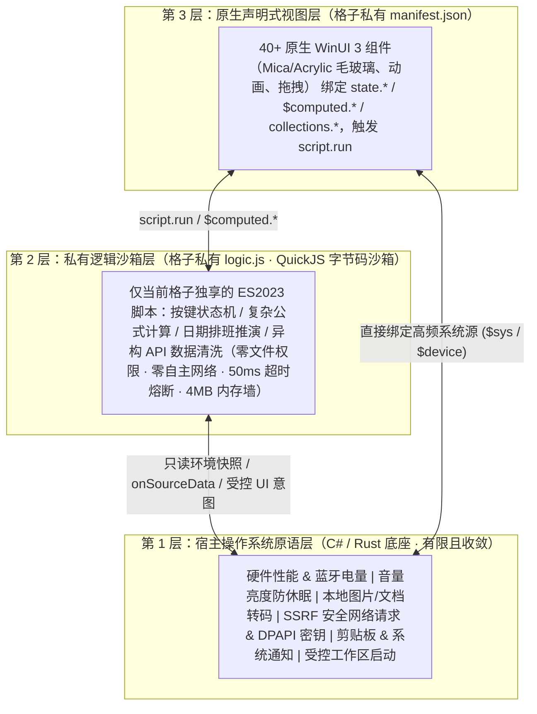

# DeskBox 自定义格子私有沙箱脚本层（`manifest.json` + `logic.js`）架构设计方案

> **状态**：已确认定稿（Approved Design Spec）  
> **目标**：在不牺牲 DeskBox **原生 WinUI 3 毛玻璃质感**、**常驻极低内存**、**NativeAOT 零反射编译**与 **`.deskbox-widget` 分享包绝对安全**的前提下，彻底解除纯静态 JSON 在复杂交互与长尾业务逻辑上的表达上限，让用户通过 AI 创建的任意格子都能拥有只属于该格子自己的私有逻辑层。

---

## 1. 背景痛点与核心设计哲学

### 1.1 当前架构的瓶颈
目前用户桌面格子目录（`%LOCALAPPDATA%\DeskBox\data\custom-widgets\<widgetId>\`）只包含声明式视图 `manifest.json` 与键值存储 `store.json`：
- **做展示很强，做逻辑极痛**：一旦用户提出稍有状态机或计算深度的需求（例如：**手机按键式四则运算计算器、房贷/个税精算、单双周课表过滤、自定义排班周期、艾宾浩斯背单词抽卡、复杂嵌套第三方 API JSON 清洗**），AI 被迫在静态 `${...}` 单行表达式里硬凑逻辑，不仅推理耗时长达上万字，最终还常被迫妥协成简陋的输入框方案。
- **靠官方手写 C# `*Engine.cs` 无法穷举长尾**：用户场景成千上万，为单一业务持续往客户端塞专用 C# 引擎既不现实，也会让主程序不断膨胀。

### 1.2 根治思路：三层职责解耦（OS 归宿主，逻辑归 `logic.js`，渲染归原生 WinUI）



- **简单格子保持零负担**：纯展示/打卡小格子依然只需一份 `manifest.json`，**`logic.js` 完全可选**，100% 兼容现有全部模板与用户格子。
- **复杂格子原地起飞**：凡遇状态机、计算公式、复杂过滤或古怪 API 格式，AI 直接在该格子自己的文件夹内生成 `logic.js`，**只存在于这个格子的工作区、只服务这一个格子**，无需修改一行客户端 C# 代码。

---

## 2. 沙箱引擎选型与「零空闲内存」架构

### 2.1 为什么选型 `QuickJS-NG`（对比其他方案）

DeskBox 同时面向本地 Debug JIT、x64 单元测试、Microsoft Store MSIX 以及严格开启 `<PublishAot>true</PublishAot>` + `<SuppressTrimAnalysisWarnings>false</SuppressTrimAnalysisWarnings>` 的 `win-x64` / `win-arm64` NativeAOT 发布包：

| 候选引擎 | 语言栈与体积 | ES 标准完整度（AI 一次写对率） | NativeAOT & Trim 零警告 | 硬性死循环/内存爆破熔断 | 结论 |
| :--- | :--- | :--- | :--- | :--- | :--- |
| **`QuickJS-NG` (推荐)** | 纯 C 编译为轻量原生 `deskbox_qjs.dll`（约 **`380 KB`**） | **ES2023 完整支持**（含 `Date`/`RegExp`/`Map`/`Array` 全套方法，AI 零幻觉） | **100% 零反射**（纯 C ABI `[LibraryImport]` P/Invoke） | **原生支持** `JS_SetMemoryLimit` + `JS_SetInterruptHandler` | **首选方案** |
| `Jint` (.NET) | 纯 C# NuGet（约 `3.2 MB`） | 较高 | 存在反射互操作路径，易触发 AOT Trim 警告且包体偏大 | 内存上限控制较弱（共享托管堆） | 不采用 |
| `boa_engine` (Rust) | 纯 Rust（约 `4.5~6 MB`） | 高 | 零反射 | 编译慢、产物体积偏大 | 备选 |
| WebView2 隐藏页 | Chromium 进程（**`80~150 MB`/实例**） | 100% | 兼容 | 进程太重，吃光常驻内存预算 | 严禁用于逻辑层 |

> **构建链路对齐注意事项**：仓库内现有的 `deskbox_native.dll` 在普通本地 Debug 构建中默认关闭（`DeskBoxRustNative=false`），而 `DeskBox.ThumbnailProxy.exe` 默认开启增量构建拷贝。`deskbox_qjs.dll` 应采用与 `ThumbnailProxy` 相同的增量构建缓存策略（源码未变时 `SkipUnchangedFiles="true"` 零耗时），确保**日常 `dev-restart.ps1`、`dotnet test -p:Platform=x64`、Store MSIX 与零售 NativeAOT（x64/ARM64）四条链路行为 100% 一致**。

### 2.2 核心性能设计：「字节码常驻 + 瞬态 `JSContext` 池化（0 空闲堆内存）」

桌面小组件 **99.9% 的时间处于静置展示状态**。为了绝不拖累 DeskBox 的常驻内存指标，**严禁为每个格子常驻保活一个独立的 JS 虚拟机实例**：

1. **加载期预编译**：当格子加载或保存 `logic.js` 时，调用 `JS_Eval(..., JS_EVAL_FLAG_COMPILE_ONLY)` 将源码编译为紧凑的 QuickJS 字节码 `byte[]`（一段 100 行的计算器脚本编译后仅 **`~3 KB`**），保存在该格子的 `CustomWidgetViewModel` 内存中。
2. **静置期零占用**：没有点击或刷新事件时，该格子在内存中**仅占 `3 KB` 字节码数组**，没有任何常驻 JS 对象堆。
3. **触发期亚毫秒执行**：当用户点击按钮 (`script.run`) 或网络源返回数据时，在进程级共享的单例沙箱 `JSRuntime` 上瞬时创建一个全新干净的 `JSContext`（耗时 `< 0.15 ms`），注入当前格子的 `ctx` 快照，执行字节码导出函数，提取状态变更 Diff 后**立即销毁 `JSContext`**。
   - **收益 1（极致省内存）**：哪怕桌面同时放 20 个带复杂脚本的自定义格子，总计增加的常驻内存也 **不足 `1 MB`**。
   - **收益 2（天然跨格隔离）**：每次调用都是全新纯净的 `JSContext`，A 格子的脚本绝对不可能通过污染 `Object.prototype` 或全局变量影响到 B 格子。

---

## 3. 工作区文件结构与三大 AI 创作通道无缝衔接

### 3.1 单个格子的物理工作区目录

```text
%LOCALAPPDATA%\DeskBox\data\custom-widgets\<widgetId>\
├── manifest.json          # 声明式原生 WinUI 3 布局、settings、sources、capsule（永远保持清爽极简）
├── logic.js               # 【新增 · 可选】仅属于该格子的私有业务逻辑脚本（上限 128 KB）
├── i18n.json              # 【新增 · 可选】仅属于该格子的独立多语言词典包（不污染主程序 Strings/*.json）
├── store.json             # 持久化数据（settings / state / collections）
├── brief.md               # 工坊共享设计简报
└── revisions.json         # 版本历史（v1, v2... 原子快照 manifest.json + logic.js + i18n.json）
```

### 3.2 三大创作通道如何一次输出双文件（零摩擦拆包设计）

用户既可能在工坊内直接调 API，也可能复制网页版豆包/ChatGPT 的回复，还可能用外部 Claude Code / Cursor 直接改目录。系统通过 **“磁盘物理分离 + 传输自动拆包”** 同时完美兼容三种模式：

1. **通道一：工坊内置 API 流式共创（Direct API）**
   - 工坊多轮共创 JSON 信封新增可选字段 `"logicJs"`（若上一轮已有 `logic.js` 且本轮仅微调 UI 颜色，AI 可省略 `"logicJs"` 表示保留原脚本不变，节省 Token！）。
   - 流式进度条新增阶段提示：`理解需求` → `编写交互逻辑` → `组装原生界面` → `沙箱预检校验`。
2. **通道二：网页 AI 复制粘贴模式（豆包 / DeepSeek 网页 / ChatGPT / Claude）**
   - 用户依然**只需点一次复制、回工坊自动识别**！
   - 剪贴板提取器升级为 `ExtractWidgetBundleFromClipboard(rawText)`，同时兼容两种返回格式：
     - **标准双代码块格式**（提示词默认引导，可读性最好、JSON 转义零出错）：一个 ```` ```json ```` 代码块 + 一个紧随其后的 ```` ```js ````（或 `javascript`）代码块；
     - **单 JSON 内联兜底格式**：若部分模型把脚本写在了顶层 `"script": "..."` 字符串字段内，解析器自动将其剥离写入 `logic.js` 并净化 `manifest.json`。
3. **通道三：外部 Agent / IDE 实时目录连接（Cursor / Claude Code / Codex / CLI）**
   - 外部 Agent 在工作区目录直接读写标准的 `manifest.json` 与 `logic.js`（获得完整的 JS 语法高亮与静态检查）。
   - `FileSystemWatcher` 同时监听 `manifest.json` 与 `logic.js`，采用 `150ms` 合并防抖窗口：Agent 连续保存两个文件时只触发一次原子热重载，200ms 内桌面与工坊同步刷新。
   - CLI 校验命令同步升级：`DeskBox.exe widget validate --file manifest.json` 自动连带编译校验同目录下的 `logic.js`。

---

## 4. `logic.js` 编程模型与 `manifest.json` 绑定契约

为了让各类大模型（包括轻量快速的 `deepseek-chat`、`gpt-4.1-mini`）**零学习成本、一次生成 100% 跑通**，API 设计完全贴合标准 ES Module 直觉，避免任何晦涩专有语法。

### 4.1 四大标准钩子与具名动作导出

```javascript
// logic.js — 运行于独立无状态 QuickJS 沙箱（ES2023）

// 1. [可选] 格子初始化或用户在设置面板修改 settings 后触发
export function onInit(ctx) {
  syncDerivedView(ctx);
}

// 2. [核心] 任意具名交互函数 —— 对应 manifest.json 中的 { "type": "script.run", "fn": "..." }
export function pressKey(ctx, key) {
  // 直接读写 ctx.state（自动持久化到 store.json）或 ctx.computed（纯内存视图变量，零磁盘写入）
}

// 3. [可选] 网络数据源（httpJson / rss）拉取成功后的自定义转换钩子
export function onSourceData(ctx, sourceId, rawData) {
  // 任意清洗深层嵌套 JSON、计算涨跌幅、过滤排序后写入 ctx.computed 或 ctx.collections
}

// 4. [可选] 按需定时心跳（仅当 manifest 声明了 "script": { "tickIntervalMs": 60000 } 时触发）
export function onTick(ctx) {
  // 例如：每分钟重新计算“距离下一节课还有几分钟”、“跨国城市当前是否处于工作时段”
}
```

### 4.2 `ctx` 上下文契约（持久化 `state` 与瞬态 `$computed` 双轨分离）

| 属性 / 方法 | 读写权限 | 落盘行为 | 用途与前端绑定方式 |
| :--- | :--- | :--- | :--- |
| `ctx.state` | **可读写** | **自动持久化至 `store.json`** | 跨重启保留的用户状态（如计算器当前算式、选中的货币、累计打卡值）。前端绑 `${state.<key>}`。 |
| `ctx.computed` | **可读写** | **纯内存，零磁盘写入** | **高性能派生视图状态 & 派生列表**（如实时换算出的 6 国货币数组、倒计时文本、课表今日过滤结果）。前端绑 `${$computed.<key>}` 或 `List` `"items": "$computed.rows"`，避免高频刷新磨损磁盘！ |
| `ctx.collections` | **可读写** | **按需持久化至 `store.json`** | 提供 `.get(name)`、`.set(name, list)`、`.add(name, item)`、`.remove(name, id)`、`.clear(name)`，受单集合 `maxItems`（上限 500）保护。 |
| `ctx.settings` | 只读 | 由设置面板管理 | 读取用户在设置页配置的偏好项（`ctx.settings.baseCurrency` 等）。**注：`secret` 密钥绝不注入 `ctx`！** |
| `ctx.event` | 只读 | 瞬态 | 当前触发动作附带的参数：`ctx.event.arg`（按钮传入的常量）、`ctx.event.value`（`Slider`/`Input`/`Toggle` 的实时 `${$value}`）、`ctx.event.item`（列表行点击时的当前项）、`ctx.event.drop`（拖入文件元数据）。 |
| `ctx.env` | 只读 | 瞬态 | 当前本机时间（`nowMs`, `isoDate`, `timeZone`, `dayOfWeek`）、界面语言 `locale`，以及已声明的系统快照（`sys`, `device`, `weather`）。 |
| `ctx.t(key, fallback, ...args)` | 只读辅助 | 瞬态 | 读取当前格子独立 `i18n.json`（或内联 `i18n`）在激活语言下的词条并支持 `{0}` 占位替换；单语言未配词典时直接返回 `fallback`，让脚本动态文案与胶囊摘要零成本支持国际化。 |
| `ctx.ui` | 受控意图 | 瞬态队列 | `ctx.ui.toast(msg)`（轻提示）、`ctx.ui.copy(text)`（仅限用户点击动作内复制剪贴板）、`ctx.ui.notify(title, body)`（带冷却限流的系统通知）、`ctx.ui.refreshSource(id)`（请求刷新已声明的数据源）。 |

### 4.3 `manifest.json` 新增极简对接语法

在 `manifest.json` 中仅需新增 **1 个动作类型 (`script.run`)**、**1 个可选顶层配置块 (`script`)** 与 **`$computed.*` 命名空间**：

```json
{
  "schemaVersion": 1,
  "id": "custom.fx-keypad-calc",
  "name": "汇率计算器",
  "script": {
    "entry": "logic.js",
    "tickIntervalMs": 0
  },
  "sources": [
    {
      "id": "fx",
      "type": "httpJson",
      "url": "https://open.er-api.com/v6/latest/${$settings.baseCurrency}",
      "intervalMs": 3600000
    }
  ],
  "view": {
    "type": "Stack",
    "children": [
      { "type": "Text", "text": "${state.expr}", "style": "caption", "color": "secondary" },
      { "type": "Text", "text": "${$computed.displayResult}", "style": "hero" },
      {
        "type": "Grid",
        "columns": "*,*,*,*",
        "spacing": 6,
        "children": [
          { "type": "Button", "text": "7", "onClick": { "type": "script.run", "fn": "tap", "arg": "7" } },
          { "type": "Button", "text": "8", "onClick": { "type": "script.run", "fn": "tap", "arg": "8" } },
          { "type": "Button", "text": "9", "onClick": { "type": "script.run", "fn": "tap", "arg": "9" } },
          { "type": "Button", "text": "⌫", "onClick": { "type": "script.run", "fn": "tap", "arg": "BS" } }
        ]
      },
      {
        "type": "List",
        "items": "$computed.convertedList",
        "itemTemplate": {
          "type": "KeyValueRow",
          "label": "${$item.currency}",
          "value": "${$item.formatted}"
        }
      }
    ]
  }
}
```

对比之前纯 JSON 模式：AI 不再需要思考 17,000 字去硬拼加减乘除状态，只需写 35 行干净直观的 `logic.js`，即可同时实现**完整四则括号按键计算器 + 实时联动多币种换算列表 + 点击行复制金额**！

---

## 5. 六道安全沙箱防线（支持放心导入社区 `.deskbox-widget`）

因为 DeskBox 支持导出和导入他人分享的 `.deskbox-widget` / `.dbbox` 包，引入 `logic.js` 必须保证 **“即便运行来路不明的第三方格子脚本，也 100% 无法逃逸、无法窃密、无法卡死主程序”**：

1. **零文件系统、零进程、零原生模块权限**：
   - QuickJS 初始化时**不注册** `std`、`os`、`Worker` 或任何本地文件/命令函数，禁用动态 `import()` 外部路径（仅允许单文件 `logic.js` 内聚执行）。
2. **零自主网络出口（彻底阻断隐私外传）**：
   - `logic.js` 内部**不提供 `fetch`、`XMLHttpRequest` 或 `WebSocket`**！
   - 格子若需联网获取数据，仍必须在 `manifest.json` 的 `sources` 中显式声明 URL，继续 100% 受 `CustomWidgetNetworkSourceEngine` 的 **SSRF 内网拦截、DNS 重绑定校验与社区域名授权门禁**保护；`logic.js` 只能在 `onSourceData` 中被动接收返回结果，不可能把用户剪贴板或状态偷偷 POST 到攻击者服务器。
3. **DPAPI 密钥硬隔离**：
   - `"type": "secret"` 存储的 API Key / Token 仅在 C# 网络请求层插值进 HTTPS Header，**绝不传入 `ctx.settings` 或任何 JS 可见对象**。
4. **50ms CPU 硬中断熔断（防 `while(true)` 与正则死锁）**：
   - 通过 `JS_SetInterruptHandler` 绑定高精度 `Stopwatch` 时间戳：单次脚本调用超过 **`50 ms`**（初始化与 `onSourceData` 放宽至 `100 ms`）立即在字节码指令边界强制中断，返回友好诊断且绝不阻塞 WinUI 界面线程。
5. **4 MB 独立内存墙与集合配额**：
   - 通过 `JS_SetMemoryLimit(rt, 4 * 1024 * 1024)` 与 `JS_SetMaxStackSize(rt, 256 * 1024)` 锁死上限；恶意脚本执行 `"a".repeat(1e9)` 仅在沙箱内瞬间返回内存超限错误，绝不影响宿主进程 GC。`logic.js` 源码大小限制 `<= 128 KB`。
6. **剪贴板与通知防滥用门禁**：
   - `ctx.ui.copy(...)` 仅在用户主动交互触发的 `script.run` 调用栈中生效，`onInit` / `onTick` / `onSourceData` 后台静默调用自动忽略；`ctx.ui.notify(...)` 内置单格子最小冷却间隔（如 `>= 60s`），防止弹窗轰炸。

---

## 6. 工坊自愈闭环、版本管理与分享打包配套

1. **沙箱预检干跑校验器（`CustomWidgetScriptValidator`，让坏代码不过夜）**：
   - 当 AI 生成完 `manifest.json` + `logic.js` 后，在呈现给用户之前自动执行 **3 步毫秒级预检**：
     1. **字节码语法编译检查**：捕获任何 JS 语法错误及精确行号列号；
     2. **双向契约静态核对**：扫描 `manifest.json` 中所有 `{ "type": "script.run", "fn": "xxx" }`，确认 `logic.js` 确实 `export` 了同名函数（消除拼写错位假按钮！）；同时确认若存在 `logic.js` 导出 `onTick` 但未配 `tickIntervalMs` 时给出修复提示；
     3. **`onInit` 沙箱冒烟干跑**：用模拟上下文试跑一次 `onInit(mockCtx)`，当场捕获 `TypeError: Cannot read properties of undefined` 等运行时异常！
   - 一旦预检报错，直接复用工坊现有的 **自动单轮自愈机制 (`CustomWidgetAiGeneratorService`)**，将精确的 JS 报错行号与堆栈发回大模型自动修复！
2. **版本历史 (`revisions.json`) 原子化**：
   - `StudioPersistedRevision` 扩充可选字段 `LogicJs` 与联合哈希；用户在工坊顶部点击撤销 `↶` / 重做 `↷` 切换 `v1 ↔ v2` 时，`manifest.json` 与 `logic.js` **永远成对原子切换**，绝不发生界面与脚本版本错位。
3. **`.deskbox-widget` 导出与导入升级**：
   - `CustomWidgetPackageService` 导出时自动收纳 `logic.js`，并同样经过 `SanitizeForSharing` 脱敏扫描（剥离硬编码本机路径 `%USERPROFILE%` 与疑似明文密钥）；导入时执行相同的语法与大小门禁校验。
4. **AI 提示词智能按需路由（不滥用脚本）**：
   - 在 `SKILL.md` 与系统提示词中明确指导 AI：
     - **纯展示、简单增删打卡、基础系统开关** → 仅输出 `manifest.json`（保持最简）；
     - **计算器、多步交互状态机、自定义日期/排班/课表规则、游戏、复杂接口数据转换** → 自动输出 `manifest.json` + `logic.js`！

---

## 7. 工坊对话页 UI、提示词路由与全链路配套规范

> **核心交互原则**：对普通用户保持**零门槛无感**（绝不在对话页塞“开启脚本模式”开关或把界面做成程序员双栏 IDE），将可控性与鲁棒性做进**三级提示词护栏、三态增量协议与左侧预览异常一键自愈闭环**中。

### 7.1 三级按需提示词护栏（防止简单格子滥用脚本）

直接复用 `CustomWidgetCapabilityRegistry` 的三级按需注入机制，新增标准能力规格 `@script`：
1. **Tier 0 全局目录（常驻极简 2 行铁律）**：
   - 常规静态信息展示、简单增删打卡（`state.*` / `collection.*`）、基础系统控制**严禁生成 `logicJs`**，保持单文件 `manifest.json` 极速输出；
   - 仅当涉及**按键状态机（如计算器/小游戏）、多步公式精算、自定义课表/排班周期推演、异构深层嵌套 API JSON 清洗**时，启用 `script.run` + `logic.js`。
2. **Tier 1 完整 `ctx` 契约与黄金范例（按需动态挂载）**：
   - 仅当本轮用户需求命中计算/状态机/排班/清洗等触发词、当前格子已存在 `logic.js`、或用户在底部 `[能力模块]` 手动勾选 `@script` 时，才向 User Prompt 注入完整的 `logic.js` 四大钩子契约与范例，保证日常简单格子的 Prompt 体积 **0 膨胀**。
3. **冷启动零空白铁律（`onInit` 同步兜底）**：
   - 凡在视图中使用 `${$computed.*}` 或 `"items": "$computed.*"` 的格子，`onInit(ctx)` **必须同步写入合法的初始默认值**（严禁仅依赖异步网络回调 `onSourceData` 才首次赋值），彻底杜绝首屏出现 `undefined`、`NaN` 或空列表闪烁。

### 7.2 多轮共创「双源上下文 + 三态增量协议」（防改样式冲掉逻辑、提速 50%）

1. **双源上下文注入（`BuildStudioCoCreationUserPrompt`）**：
   - 当当前工作区/草稿中存在非空 `logic.js` 时，在 `## Current manifest.json (Source of Truth)` 下方同步附带 `## Current logic.js (Source of Truth)`，确保后续轮次增改按钮（如“加一个退格键”）时，AI 能精确衔接已有状态字段与导出函数。
2. **返回信封 `"logicJs"` 三态语义（`BuildStudioCoCreationSystemPrompt`）**：
   ```json
   {
     "kind": "edit",
     "reply": "...",
     "changeSummary": "...",
     "manifest": { "schemaVersion": 1, "...": "..." },
     "logicJs": "省略该字段 = 沿用上一版 logic.js | 非空字符串 = 新增或更新脚本 | null = 移除脚本"
   }
   ```
   - **省略 `"logicJs"`（默认保留态）**：当用户本轮仅做纯视觉调整（如“字体放大一点”、“颜色更柔和”），AI **无需重复输出整段 JS 代码**，客户端直接沿用上一版本的 `logic.js` —— **既砍掉近一半流式等待时间，又 100% 杜绝调样式时误改算术逻辑**。
   - **非空代码字符串**：本轮创建或修改了 `logic.js` 逻辑。
   - **显式 `null`**：清理并移除当前格子的脚本层。

### 7.3 工坊对话页 UI 的 4 个轻量可控触点（`CustomWidgetStudioWindow`）

保持现有的「左实时舞台 + 右共创对话流」布局不变，精准补齐 4 个闭环触点：
1. **左侧预览舞台「试玩报错 → 一键让 AI 修复」闭环**：
   - 交互脚本的边缘 Bug（如除零、空数组越界、超过 `50ms` 超时熔断）往往在用户在左侧预览台亲手点击试玩时才触发。
   - 当 `_previewVm` 捕获任何 `logic.js` 运行时异常或中断时，除沙箱安全兜底不崩外，在右侧输入框上方弹出温和诊断条：
     `⚠ 点击「=」时脚本计算异常 (logic.js:28)  [✨ 让 AI 自动修复]`
   - 点击按钮即将 **精确报错行号与堆栈 + 触发的 `fn` 与参数 + 当前 `state` 快照** 自动填入共创轮次，单轮精准自愈，无需用户口头描述“为什么点了没反应”。
2. **`◎ 点选定位` 自动穿透关联脚本函数（`OnPreviewNodePicked`）**：
   - 当用户在左侧点选某个组件（如计算器的 `=` 按钮）时，若该节点绑定了 `{ "type": "script.run", "fn": "evaluate" }` 或引用了 `${$computed.total}`，注入给 AI 的 `Focused Target Node` 提示自动附带：**“该组件关联 `logic.js` 中的 `export function evaluate(ctx)` / `$computed.total`”**，实现指哪打哪。
3. **对话历史卡片 `DiffPills` 感知脚本变更（`CustomWidgetHealthAnalyzer`）**：
   - 扩充 `ComputeStructuralDiff`：即使某轮仅修改了计算公式而 `manifest.json` 布局未变，也在回复卡片底部生成清晰的变更胶囊（如 `⚡ 新增交互逻辑 (tap, evaluate)` 或 `⚡ 更新计算脚本`），与顶部 `v1 / v2` 版本切换清晰对应。
4. **流式进度胶囊与 `</>` 代码查看器升级（`BuildInPlaceDirectStreamingCard`）**：
   - 流式输出检测到 `"logicJs"` 时，步骤胶囊动态显示为 `2 · 编写逻辑与界面`、`3 · 界面与沙箱预检`；
   - 面向开发者排查的右上角 `</>` 面板支持切换查看格式化后的 `[manifest.json | logic.js]`，告别阅读带 `\n` 转义的单行 JSON 字符串。

### 7.4 网页版 AI 与外部代码工具配套升级

1. **网页版 AI（豆包 / ChatGPT / DeepSeek 网页）双代码块协议**：
   - 网页提示词模板引导输出 **一个 ```` ```json ```` 代码块 + 一个紧随其后的 ```` ```js ```` 代码块**（彻底规避大模型手写 JSON 多行转义双引号出错）；用户仍只需点一次“复制全文”，`ExtractWidgetBundleFromClipboard` 自动拆包并执行沙箱预检，若预检不通过则同样支持一键复制带脚本行号的修复指令回网页端。
2. **「在代码工具中打开」双文件同步与监听（`OpenInCodeToolAsync` / `StartCodeToolWatcher`）**：
   - 打开外部编辑器时同步将草稿中的 `manifest.json` 与 `logic.js`（如有）落盘至工作区；
   - 将原先仅监听单文件 `manifest.json` 的 `FileSystemWatcher` 升级为同时监听 `manifest.json` 与 `logic.js`（`150ms` 合并防抖窗口），使外部 Cursor / Claude Code 保存 JS 后工坊预览台与桌面同样在 200ms 内实时热刷新。

### 7.5 胶囊模式（Capsule Mode）能力补齐与工坊双视图切换规范

> **设计边界**：保持宿主统一精致的标准胶囊壳（高度约 `36~40px`、统一圆角毛玻璃、左端拖拽区、中部悬停展开状态机与收起 90 秒自动休眠展开视觉树），**禁止在胶囊内放开自由组件树**；通过 **「原生高颜值槽位全接通 + `logic.js` `$computed` 动态投影 + 工坊 `[展开 | 胶囊]` 实时预览与上下文联动」** 实现体验闭环。

1. **桌面原生胶囊能力全接通（`CustomWidgetManifest` + `ContentWidgetWindow`）**：
   - 补齐 `CreateCustomCompactPresentation` 映射：点亮 `WidgetShell` 原生右上角彩色独立角标（`BadgeText: viewModel.CapsuleBadge`）与更新微弹跳反馈（`EnableBounceOnUpdate: viewModel.CapsuleEnableBounce`）；
   - 在 `CustomWidgetCapsuleSpec` 新增可选快捷动作字段 `primaryAction`，并在 `ContentWidgetWindow.OnCompactPrimaryActionRequestedAsync()` 中打通自定义格子触发链路（支持所有原生动作及 `script.run`）：
     ```json
     "capsule": {
       "title": "${$computed.capsuleTitle}",
       "summary": "${$computed.capsuleSummary}",
       "glyph": "💧",
       "badge": "${state.streak}天",
       "badgeIsWarning": "${$computed.isBehindSchedule}",
       "progress": "${$computed.goalPercent}",
       "enableBounceOnUpdate": true,
       "primaryAction": {
         "icon": "\uE710",
         "tooltip": "记一杯水 (+200ml)",
         "onClick": { "type": "script.run", "fn": "addWaterCup" }
       }
     }
     ```
     收起状态下悬停胶囊右侧即可一键完成打卡 `+200ml`、番茄钟启停或行情/额度刷新，无需展开主窗口。
2. **工坊预览舞台新增 `[ ▢ 展开 | 💊 胶囊 ]` 实时切换（`BuildStageTopToolbar`）**：
   - 在左侧舞台顶部工具栏放入轻量切换控件；切至 **`💊 胶囊`** 时，舞台中央按桌面真实胶囊形态 1:1 实时渲染（同步适配 `[🖼 壁纸 | ☀ 浅色 | 🌙 深色]` 背景切换，直观检验壁纸对比度与文案长度），并支持直接点击测试胶囊右侧 `primaryAction` 按钮。
3. **「视图感知」对话与提示词联动**：
   - **默认好胶囊准则**：System Prompt 与 Tier 0 目录明确要求新建格子时同步生成高信息密度的默认 `"capsule"`（提炼核心实时指标与进度，而非复读静态简介）；
   - **胶囊视图焦点注入**：当工坊左侧处于 `💊 胶囊` 预览态时，底部快捷建议气泡自动切换为胶囊专属灵感（如 `⚡ 胶囊显示实时换算结果`、`⚡ 加个不展开一键打卡按钮`、`⚡ 底部加上进度条`），且用户发送消息时自动注入 `## Active Studio Viewport: Capsule Mode ($.capsule)`，引导 AI **保持展开态 `view` 不变，精准只改 `"capsule"`（及必要的 `$computed` 字段）**；
   - **变更胶囊感知**：`DiffPills` 同步识别并展示 `💊 更新胶囊视图`。

### 7.6 单格独立 `i18n.json` 旁路多语言与工坊一键 AI 同步规范

> **背景痛点**：一方面，自定义格子的业务文案绝不能塞进宿主 `src/DeskBox/Strings/*.json`（避免主语言文件无限膨胀）；另一方面，若像早期内置模板那样把 13 国词典内联塞在 `manifest.json` 内部，会导致百行 `manifest.json` 暴涨至 600~800 行，用户在工坊每轮对话微调样式都要重复收发整套 13 国词典，白烧 5 倍 Token 且拖慢流式响应 15~20 秒。

1. **物理旁路隔离（`<widgetId>/i18n.json`）+ 100% 向下兼容**：
   - 每个格子在自身工作区目录下维护独立可选的 `i18n.json`（结构与原顶层 `"i18n"` 一致：`{ "zh-CN": {...}, "en-US": {...}, ... }`）；
   - 运行时 `CustomWidgetDataStore` 与 `ResolveI18nDictionary` 优先加载同目录 `i18n.json`，同时完全兼容旧模板内联在 `manifest.json` 中的 `"i18n"` 字段；
   - `.deskbox-widget` 导出/导入与 `revisions.json` 版本历史自动纳管 `i18n.json`，主工程 `Strings/*.json` 永远保持 **0 业务词条增长**。
2. **日常共创默认「纯单语言」（极速零负担）**：
   - 用户日常对话创建与迭代格子时，AI 默认直接输出与用户语言一致的直白明文字符串，**不生成 `i18n.json`，也不在每轮共创上下文中携带庞大的多国词典**，保证最高生成速度与可读性。
3. **工坊 `[ 🌐 多语言适配 ]` 一键抽取与增量同步（按需触发）**：
   - 在工坊右上角 `⋯` 更多菜单（及分享导出前可选提示）提供 **`🌐 一键生成/同步多语言`**（可选 `中/英双语` 极速档或 `全部 13 国语言` 完整档）：
     - **首次生成**：发起专用轻量翻译请求，自动将 `manifest.json` 中的静态文案替换为 `${$i18n.<key>}`（若含 `logic.js` 动态拼装文案则替换为 `ctx.t('<key>', '默认文案')`），并将翻译结果独立写入 `i18n.json`；
     - **增量同步**：当格子已有 `i18n.json` 且后续新增/修改了部分文案时，客户端仅提取缺失或变更的词条交由 AI 增量补齐至 `i18n.json`，2~3 秒完成且绝不触碰布局与逻辑。

---

## 8. 分阶段落地路线图（4 个独立里程碑）

> 等当前另一个 Agent 的工作批次收尾后，可按以下 4 个阶段干净落地，每阶段均可独立编译与测试验收：

| 阶段 | 核心交付物 | 涉及模块 | 验收标准 |
| :--- | :--- | :--- | :--- |
| **Phase 1**<br>沙箱内核与安全护栏 | `QuickJS-NG` 原生轻量模块 (`deskbox_qjs`) + C# `[LibraryImport]` 无反射封装 `CustomWidgetScriptEngine` | `native/`、`Platform/CustomWidgetQuickJsInterop.cs`、`Services/CustomWidgetScriptEngine.cs` | 通过 x64/ARM64 编译；单测覆盖 ES2023 执行、字节码预编译复用、`while(true)` 50ms 强制熔断、`4MB` 内存超限拦截、跨 Context 零污染 |
| **Phase 2**<br>运行时、桌面胶囊与独立 `i18n.json` 打通 | `logic.js` 与旁路 `i18n.json` 读写及热重载、`script.run`、`$computed.*` 零磁盘绑定、`ctx.t(...)` 脚本多语言、`onSourceData`、`onTick`；桌面胶囊 `capsule.primaryAction` 一键快捷按钮与原生彩色 `BadgeText` / 微弹跳全接通 | `Services/CustomWidgetDataStore.cs`、`Models/CustomWidgetManifest.cs`、`Services/CustomWidgetExpressionEvaluator.cs`、`ViewModels/CustomWidgetViewModel.cs`、`Controls/WidgetContents/CustomWidgetNativeRenderer.cs`、`Views/ContentWidgetWindow.xaml.cs` | 真机运行 `manifest.json + logic.js + i18n.json` 按键汇率计算器与快捷打卡胶囊：展开态丝滑计算、收起态胶囊一键操作、切换客户端语言时界面与脚本动态文案实时切换 |
| **Phase 3**<br>工坊共创页、胶囊切换、一键多语言与自愈闭环 | 工坊舞台 `[▢ 展开 \| 💊 胶囊]` 切换与视图感知焦点注入、`🌐 一键生成/同步多语言`（独立落盘 `i18n.json`）、`CustomWidgetScriptValidator`、三态 `"logicJs"` 信封与网页双代码块拆包、预览试玩异常 `[✨ 让 AI 自动修复]`、`◎ 点选定位` 穿透 `fn`、`DiffPills`、`</> [manifest.json \| logic.js]`、三文件原子撤销与编辑器监听、`.deskbox-widget` 打包 | `Services/CustomWidgetAiGeneratorService.cs`、`Services/CustomWidgetHealthAnalyzer.cs`、`Services/CustomWidgetStudioSessionStore.cs`、`Services/CustomWidgetPackageService.cs`、`Views/CustomWidgetStudioWindow*.cs` | 工坊默认单语言极速生成复杂格子与精致胶囊；点击 `🌐 多语言适配` 自动抽词生成 `i18n.json` 且后续微调外观无需重传词典；切到 `💊 胶囊` 说话精准只改胶囊；脚本异常一键自愈 |
| **Phase 4**<br>三级提示词护栏与外部生态 | `@script` 按需能力注册与防滥用门禁、默认单语言 + 默认好胶囊 + `onInit` 零空白规范、更新 `SKILL.md` / `API_REFERENCE.md` / `CLI widget validate`、宿主 UI 新增词条补齐 | `Services/CustomWidgetTemplates.cs`、`Services/CustomWidgetCapabilityRegistry.cs`、`Strings/*.json` (仅宿主新增按钮词条) | 简单需求仍只产单文件 `manifest.json`，复杂需求自动产双文件，业务词条 0 污染主程序语言包；NativeAOT 发布审计 (`publish-aot-audit.ps1`) 零 Trim 警告通过 |
