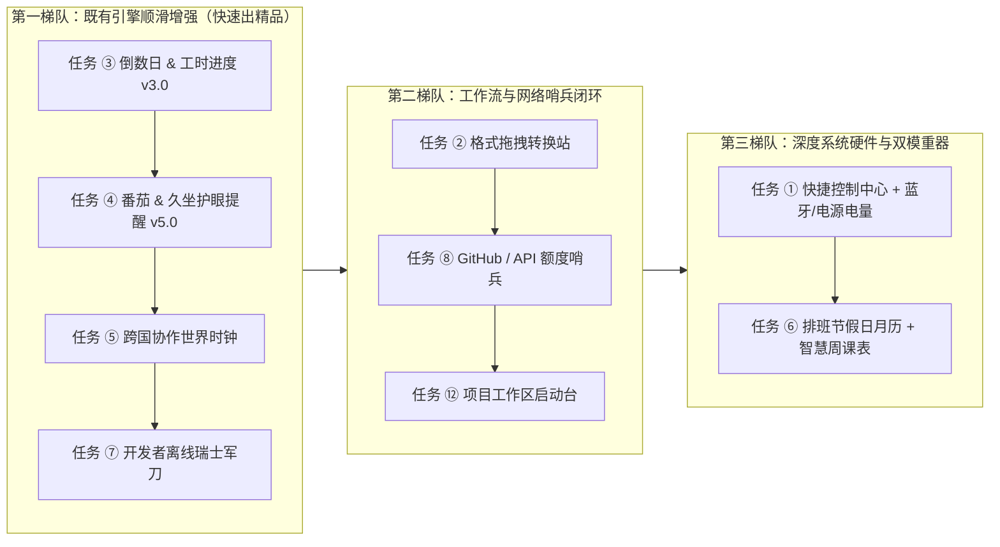

# DeskBox 工坊精选模板（9 项独立任务）产品设计与研发执行规范

> **文档用途**：本文档面向独立执行的研发 Agent（Claude Code / Codex / Cursor / Antigravity 等）。  
> **核心原则**：**每一个模板都是一个独立、闭环的垂直交付单元（1 Task = 1 Vertical Slice）**。执行任意单项任务时，请先通读「第 0 章：全局工程铁律与接入清单」，再严格按照对应编号章节的痛点边界、交互架构、`settings` 契约、C# NativeAOT 扩展方案与验收用例独立落地，严禁做成粗糙的静态 JSON 壳子或与现有格子重复的半成品。

---

## 0. 全局工程铁律与统一接入清单（执行必读）

### 0.1 范围映射：新建 vs 原位升级（严禁重复造轮子）

在 `CustomWidgetTemplates.OfficialTemplates` 现有 8 款统一官方模板基础上，本次确认立项的 **9 项任务**分为 **7 款全新官方模板** 与 **2 款既有模板原位大版本升级**（编号 `⑨ 汇率`、`⑩ 习惯热力图`、`⑪ 精选相框` 本期明确不做，不在范围内）：

| 任务编号 | 模板名称 | 预设 ID (`manifest.id`) | 交付形态 | 工坊建议分类 | 引擎改动复杂度 |
| :--- | :--- | :--- | :--- | :--- | :--- |
| **任务 ①** | 🎛️ 桌面快捷控制中心（含设备与蓝牙电量） | `deskbox.control-hub` | **新建官方模板** | 系统与控制 (`system`) | ⭐⭐⭐ 中高（需补齐电源与蓝牙外设电量采集） |
| **任务 ②** | 🔄 格式拖拽转换站 | `deskbox.drop-converter` | **新建官方模板** | 实用工具 (`utility`) | ⭐⭐ 低中（补齐 `auto` 智能路由与输出目录配置） |
| **任务 ③** | ⏳ 重要倒数日 & 时间进度 | `deskbox.countdown` | **原位升级既有模板 (v2.1 → v3.0)** | 时间与日程 (`schedule`) | ⭐⭐ 低中（在 `CustomWidgetCountdownEngine` 扩充工时/假日/发薪日规则） |
| **任务 ④** | 🍅 番茄专注 & 久坐提醒 | `deskbox.pomodoro` | **原位升级既有模板 (v4.1 → v5.0)** | 专注与健康 (`focus`) | ⭐⭐ 低中（扩充久坐护眼双模节律 + `GetLastInputInfo` 空闲重置） |
| **任务 ⑤** | 🌍 跨国协作世界时钟 | `deskbox.world-clock` | **新建官方模板** | 时间与日程 (`schedule`) | ⭐ 低（复用 `tz()`，小幅补齐时差标签与会议时间推演函数） |
| **任务 ⑥** | 📅 排班值班 & 节假日月历（融合课表） | `deskbox.schedule-calendar` | **新建官方模板** | 时间与日程 (`schedule`) | ⭐⭐⭐ 中高（扩充法定调休标识、循环排班铺设与单双周课表视图） |
| **任务 ⑦** | 🧰 开发者离线瑞士军刀 | `deskbox.dev-toolbox` | **新建官方模板** | 研发与监控 (`dev`) | ⭐⭐ 低中（在 `CustomWidgetUtilityEngine` 补齐 JWT/Unicode/UUID 离线转换） |
| **任务 ⑧** | 🐙 GitHub / API 额度哨兵 | `deskbox.github-sentinel` | **新建官方模板** | 研发与监控 (`dev`) | ⭐⭐ 低中（修复未配密钥时空 `Authorization` 请求头过滤 + 多源编排） |
| **任务 ⑫** | 🚀 项目工作区启动台 | `deskbox.workspace-launchpad` | **新建官方模板** | 实用工具 (`utility`) | ⭐⭐ 中（扩充白名单 IDE/终端安全唤起与一键批量唤醒动作） |

> **防撞车红线**：任务 ③ 必须直接升级现有的 `deskbox.countdown`，任务 ④ 必须直接升级现有的 `deskbox.pomodoro`（且必须 100% 兼容用户已保存在 `store.json` 中的历史事件与专注记录），**严禁在工坊中额外新增第二个倒数日或第二个番茄钟模板**。任务 ⑧ (`deskbox.github-sentinel`) 必须与已有的 `deskbox.ai-pulse`（专职 Claude/Codex 会话配额与国内大模型余额）严格划清职责边界。

### 0.2 声明式 Manifest 与原生玻璃视觉铁律

1. **禁止重复绘制内部标题栏**：DeskBox 宿主窗口外框已经渲染了顶层 `icon`、`name`、折叠胶囊按钮与右上角菜单（含设置入口）。`view` 根节点内部**严禁**再写一行静态组件名标题栏，把宝贵的桌面首屏空间留给核心指标与高频交互。
2. **高低频严格分离（`settings` 零死配置契约）**：
   - **主画布（高频）**：只保留一瞥即得的状态、1-Click 快捷动作、实时滑块/开关（`Slider` / `Toggle` 直接通过 `onChange` 读取 `${$value}` 即时生效，**严禁在旁边放多余的“应用/保存”按钮**）。
   - **设置面板（低频）**：凡涉及多模块显隐排序（`moduleList` + `ModuleStack` `"bind": "settings.modules"`）、目标阈值、城市时区、仓库地址、默认导出格式、API Token（必须用 `"type": "secret"` 走 Windows DPAPI 加密存储，严禁明文落盘 `manifest.json` 或 `.dbbox`）等低频偏好，全部声明在顶层 `"settings"`。
   - **静态校验门禁**：每一个声明在 `"settings"` 中的 `key`，必须在 `view`、`sources`、`capsule` 或原生引擎中真实消费（`${$settings.<key>}`、`settings.<key>` 或 `${$secrets.<key>}`）。`CustomWidgetManifestValidator` 会对未绑定的死配置项抛出告警，单元测试要求 **0 Error 且 0 Warning**。
3. **桌面折叠胶囊 (`capsule`) 契约**：所有官方模板必须精心设计顶层 `"capsule"`（`title`、`summary`、`glyph`、`badge`），折叠在桌面边缘时不能只显示死板的名字，必须动态透出当前最高优先级的状态摘要（例如低电量告警、下一节课教室、当前久坐剩余分钟、CI 构建红灯等）。
4. **深浅色与壁纸可读性**：严禁硬编码刺眼纯白/纯黑背景色，统一使用语义材质槽位（`subtle`、`card`、`inset`、`accent`、`warning`、`danger`）与语义前景色（`primary`、`secondary`、`muted`），确保在浅色玻璃、深色玻璃及高复杂度壁纸上均清晰易读。

### 0.3 代码接入点与 13 国语言全量对齐要求

每完成一个新模板或引擎能力扩展，必须同步检查以下挂载点：

1. **官方模板注册**：`src/DeskBox/Services/CustomWidgetTemplates.cs`
   - 新增或更新对应的 `*ManifestJson` 常量，并在 `OfficialTemplates` 列表中注册元数据（含 13 语言标题/简介键）。
   - 官方内置模板的 `i18n` 字典以及宿主语言包 `src/DeskBox/Strings/*.json` **必须同步覆盖全部 13 种语言**：`en-US`、`zh-CN`、`zh-TW`、`ja-JP`、`ko-KR`、`de-DE`、`es-ES`、`fr-FR`、`pt-BR`、`ru-RU`、`ar-SA`、`hi-IN`、`it-IT`（注意阿拉伯语 `ar-SA` 中严禁误翻译 `${...}` 表达式占位符）。
2. **工坊分类映射**：`src/DeskBox/Views/CustomWidgetStudioWindow.Pages.cs`
   - 新增官方模板后，更新工坊精选模板分类映射（当总数由 8 增至 15 时，可将分类标签优化为：`全部` / `系统与效率` / `时间与课表` / `研发与AI`）。
3. **能力注册表与文档同步（若新增 `$namespace` 变量 / `source` / `action` / 组件属性）**：
   - 必须同步注册到 `src/DeskBox/Services/CustomWidgetCapabilityRegistry.cs` 与 `CustomWidgetManifestValidator`，并在 13 个 `Strings/*.json` 中补齐对应的 `CustomWidget.ApiDocs.*` 本地化说明键（否则 `CustomWidgetApiDocsLocalizationTests` 会失败）。
4. **NativeAOT 零反射红线**：
   - 所有新增 JSON 序列化类型必须挂载到 `JsonSerializerContext`（源生成器），严禁使用运行时反射 `JsonSerializer.Deserialize<T>(json)` 无 Context 重载、`dynamic` 或 `Expression.Compile`。
   - 所有新增 Win32 / CfgMgr32 互操作优先使用 `[LibraryImport]` 或经过 x64 / ARM64 验证的显式结构体布局。

### 0.4 构建、测试与重启标准门禁（源自 `AGENTS.md`）

每次任务代码修改完毕后，必须按顺序执行：
1. **x64 单元测试门禁**（禁止使用默认 `AnyCPU`）：
   ```powershell
   dotnet test .\tests\DeskBox.Tests\DeskBox.Tests.csproj --no-restore --verbosity:minimal -p:Platform=x64
   ```
   > 仅当 `通过数 == 总测试数` 时视为绿灯（中途崩溃也会打印 `失败: 0`，务必核对总条数）。
2. **停止旧进程 → 编译 → 启动 canonical Debug 实例并校验时间戳**：
   ```powershell
   powershell -ExecutionPolicy Bypass -File C:\Users\simon\.agents\skills\deskbox-dev\scripts\dev-restart.ps1
   ```
   确认运行的唯一实例路径为 `D:\project\wingezi\src\DeskBox\bin\Debug\net10.0-windows10.0.22621.0\DeskBox.exe`。
3. **Git 提交规范**：提交信息与注释严禁包含任何 `Co-Authored-By`、`Generated with` 或 AI 工具署名，仅保留仓库作者身份。

---

## 任务 ①：🎛️ 桌面快捷控制中心（含设备电源与蓝牙外设电量）

- **预设 ID**：`deskbox.control-hub`（新建官方模板）
- **推荐默认尺寸**：`width: 320, height: 396`（`minSize: 280 × 240`）

### 1.1 真实用户痛点与场景边界

1. **无线外设“突然断电失联”焦虑（核心差异化痛点）**：
   - 现代桌面普遍使用蓝牙机械键盘（Keychron / NuPhy）、无线鼠标（Logitech MX Master）、蓝牙耳机（AirPods / Sony / Bose）或无线手柄。Windows 11 任务栏**完全不展示外设电量**，用户必须点进 `设置 → 蓝牙和其他设备` 三级页面才能看到，往往在开会发言或赶代码时键鼠/耳机突然没电。
   - 笔记本用户外接显示器合盖或接扩展坞工作时，也常因电源适配器松动未察觉而耗尽电池降频卡顿。
2. **系统高频开关路径过深**：
   - `Win + A` 快捷设置每次呼出都会遮挡工作区且失焦即消失；下载大文件、跑编译、看参考文档不希望屏幕自动休眠锁屏，普通用户不得不额外安装 PowerToys Awake。
3. **与现有格子边界**：
   - `deskbox.system-pulse`（硬件脉冲）负责 **CPU / 内存 / GPU / 网速性能遥测只读监控**；本模板负责 **“交互式硬件控制 + 全套设备电池续航管家”**，一读一控，完全互补。

### 1.2 产品交互与视觉架构设计

采用 `ModuleStack`（绑定 `settings.modules`）组合三大无冗余区块：

1. **模块 A：设备与蓝牙电量矩阵 (`id: "batteries"`)**
   - **本机电源行**（台式机无电池时：若 `$settings.desktopPowerDisplay == 'hide'` 则自动隐藏本机电池行，仅展示连接的外设电量；若为 `'acBadge'` 则展示紧凑的 `⚡ 交流电源直供` 状态条）：
     - 展示笔记本实时电量百分比、充放电状态图标（`⚡ 充电中` / `🔋 电池供电` / `🍃 节电模式`）以及系统估算的剩余可用时长（如 `约剩 3h 45m`）。
   - **蓝牙与无线外设电量列表**（自适应 0~6 台已连接/已缓存电量的外设）：
     - 每行采用高信息密度单行胶囊：`[设备类别图标 ⌨️/🖱️/🎧/🎮/🖊️] [设备友好名称，如 MX Master 3S] [细进度条 + 百分比]`。
     - **低电量智能高亮**：当任意设备电量 `<= $settings.lowBatteryThreshold`（默认 `20%`）时，该行自动切换为琥珀/珊瑚色警示态并带 `⚠️` 角标；当无任何蓝牙外设连接时，展示单行极简引导（`蓝牙外设连接后自动显示电量 · 点击管理蓝牙`，点击直达 `ms-settings:bluetooth`），绝不留大片空白。
2. **模块 B：高频快捷控制瓷砖 (`id: "tiles"`, 2×3 网格)**
   - `☕ 常亮防休眠`（激活态高亮主题色，副标题显示当前防休眠模式，如 `保持亮屏` / `关闭`）
   - `🌙 深浅色切换`（一键切换 Windows 系统/应用主题，副标题显示 `深色` / `浅色`）
   - `🔇 静音开关`（同步系统主音量静音状态）
   - `🗑️ 清空回收站`（实时副标题显示 `${$device.recycleBinCount} 项 · ${$device.recycleBinSizeText}`，点击执行带确认保护的清空）
   - `🎧 音频输出`（副标题滚动/截断显示当前输出设备名 `${$device.audioDeviceName}`，点击直达 `ms-settings:sound` 切换耳机/音箱）
   - `🔒 立即锁屏`（离开工位一键锁屏，社区模板带安全确认，官方内置模板直达）
3. **模块 C：音量与屏幕亮度即时推子 (`id: "sliders"`)**
   - `🔊 主音量` 实时 `Slider`（`0~100`，`onChange` 绑定 `system.control` `volume.set`）。
   - `☀️ 屏幕亮度` 实时 `Slider`（当 `$device.brightnessSupported == 'true'` 时展示；台式机外接不支持 WMI 调光的显示器自动隐藏该行，避免无效死滑块！）。
4. **折叠桌面胶囊 (`capsule`)**：
   - 智能优先级表达式：若存在低电量设备（`${$device.lowBatteryCount > 0}`），胶囊优先警示 `⚠️ ${$device.lowestBatteryName} ${$device.lowestBatteryPercent}%`；若开启了防休眠，显示 `☕ 常亮中 · 🔋 ${$device.primaryBatterySummary}`；日常态显示 `🔋 ${$device.primaryBatterySummary} · 🔊 ${$device.volume}%`。

### 1.3 `settings` 设置项清单（高低频分离）

| `key` | `type` | 默认值 | 说明与真实绑定方式 |
| :--- | :--- | :--- | :--- |
| `modules` | `moduleList` | `batteries,tiles,sliders` | 控制「设备电量 / 快捷开关 / 音量亮度推子」显隐与上下顺序（绑定 `ModuleStack`） |
| `lowBatteryThreshold` | `choice` | `"20"` | 低电量变色与通知阈值：`15%` / `20%（推荐）` / `30%` |
| `lowBatteryNotify` | `toggle` | `"true"` | 外设或本机首次跌破低电量阈值时发送一次系统桌面通知（防重复轰炸去重） |
| `desktopPowerDisplay` | `choice` | `"hide"` | 台式机无内置电池时的电源行表现：`hide`（自动隐藏本机电源行）/ `acBadge`（显示交流供电状态） |
| `onlyConnectedPeripherals` | `toggle` | `"true"` | 仅展示当前在线连接的蓝牙外设（关闭则同时置灰展示最近配对过的离线设备上次已知电量） |

### 1.4 C# 引擎现状审计与 NativeAOT 实现方案

- **现状审计**：
  - `src/DeskBox/Services/CustomWidgetSystemControlService.cs` 已完整实现音量、静音、WMI 亮度、防休眠 (`SetThreadExecutionState`)、深浅色切换、回收站统计/清空、锁屏与媒体控制，**但 `CustomWidgetDeviceStateSnapshot` 目前没有任何电池与外设电量字段**。
- **扩展落地方案（100% NativeAOT 安全、零外部进程调用、零反射）**：
  1. 新建 `src/DeskBox/Services/CustomWidgetBatteryTelemetryReader.cs`（由 `CustomWidgetSystemControlService` 按低频节流调度：本机电源每 `15s` 刷新，外设电量每 `60s` 及收到 `WM_DEVICECHANGE` / 手动刷新时采样，绝不高频唤醒休眠蓝牙鼠标耗电）：
     - **第 1 层 — 本机/UPS 电池 (`kernel32.dll!GetSystemPowerStatus`)**：读取 `ACLineStatus`（交流电接入）、`BatteryFlag`（是否存在系统电池 `!= 128`）、`BatteryLifePercent`、`SystemStatusFlag`（节电模式）、`BatteryLifeTime`（剩余秒数，格式化为 `Xh Ym`）。
     - **第 2 层 — 蓝牙经典与 BLE 外设 PnP 属性直读 (`CfgMgr32.dll`)**：
       - Windows 10/11 蓝牙协议栈会将经典蓝牙（HFP 耳机）和 BLE GATT Battery Service (`0x180F`) 键鼠/耳机的电量直接缓存在 PnP 设备节点属性中，无需打开蓝牙句柄即可毫秒级无感读取！
       - 使用 `CM_Get_Device_ID_ListW` 枚举 `BTHENUM`、`BTHLE`、`BTHLEDevice` 及蓝牙关联 `HID` 节点，`CM_Locate_DevNodeW` + `CM_Get_DevNode_PropertyW` 读取：
         - **电量百分比**：`DEVPKEY_Bluetooth_Battery` = `DEVPROPKEY({104EA319-6EE2-4701-BD47-8DDBF425BBE5}, 2)`（`DEVPROP_TYPE_BYTE`，`0~100`）。
         - **设备名称**：优先读 `DEVPKEY_Device_FriendlyName`，回退 `DEVPKEY_Device_BusReportedDeviceDesc` / `DEVPKEY_Device_DeviceDesc`。
         - **在线连接态**：读取 `DEVPKEY_Bluetooth_IsConnected` 或关联子节点 `CM_Get_DevNode_Status`（`DN_STARTED`），并按蓝牙 MAC 地址 / ContainerId 去重（同一个双模键盘/立体声耳机常有多个子接口节点，必须按 `DEVPKEY_Device_ContainerId` 聚合去重！）。
         - **设备类型图标推断**：结合 `DEVPKEY_Device_Class`、蓝牙 CoD / BLE Appearance 与名称关键词映射为 `keyboard` (`⌨️`)、`mouse` (`🖱️`)、`audio` (`🎧`)、`gamepad` (`🎮`)、`pen` (`🖊️`)、`device` (`🔋`)。
     - **第 3 层 — 2.4GHz 无线接收器 HID 电池补充 (`Windows.Devices.Power.Battery`)**：
       - 对支持标准 HID Power Device 协议的 2.4G 无线鼠标底座/接收器，通过 `Battery.GetDeviceSelector()` + `Battery.FromIdAsync` 读取 `GetReport()` 的 `RemainingCapacityInMilliwattHours / FullChargeCapacityInMilliwattHours`（排除系统主电池 `SystemBattery` 后按 ContainerId 合并补充）。
  2. **暴露给声明式引擎的数据面**：
     - 扩充 `$device.*` 标量：`hasSystemBattery`、`batteryPercent`、`batteryCharging`、`batterySaver`、`batteryRemainingText`、`brightnessSupported`、`peripheralBatteryCount`、`lowBatteryCount`、`lowestBatteryName`、`lowestBatteryPercent`、`primaryBatterySummary`。
     - 注入只读动态集合 `collections.deviceBatteries`（字段：`id`、`name`、`kind`、`icon`、`percent`、`statusText`、`isCharging`、`isLow`、`isConnected`），供 `Repeater` 或原生电量列表渲染。
     - 同步更新 `CustomWidgetCapabilityRegistry.cs` 与 13 语言 `Strings/*.json` 文档键。

### 1.5 独立验收清单

- [ ] 笔记本与无电池台式机两种快照模拟下，主画布均不出现死滑块（无亮度支持自动隐藏亮度条）或空白电源卡。
- [ ] 同一个蓝牙耳机/键鼠在系统存在多个子 DevNode 时，按 `ContainerId` 准确合并为 1 条记录，不重复显示。
- [ ] 低电量阈值切换（15% / 20% / 30%）实时改变告警徽标与折叠胶囊文案；首次低电通知具有单设备冷却去重，不反复弹窗。
- [ ] `CustomWidgetAgentStudioTests` 新增 `deskbox.control-hub` 静态零告警校验 + `ContainerId` 电池聚合单测，x64 测试全绿。

---

## 任务 ②：🔄 格式拖拽转换站

- **预设 ID**：`deskbox.drop-converter`（新建官方模板）
- **推荐默认尺寸**：`width: 328, height: 376`（`minSize: 280 × 260`）

### 2.1 真实用户痛点与场景边界

1. **隐私安全与零启动摩擦**：
   - 日常办公高频遇到：网页保存的图片是 `.webp` 无法插入老旧文档/系统；开发客户端需要把 `.png` 秒转包含多尺寸图层的 `.ico`；运营需要把 `.csv` 与 `.json` 互转或格式化；下载大安装包需要核对 `SHA-256` 指纹。
   - 在线转换网站充斥广告、限制文件大小，且**上传公司内部截图、表格数据存在严重泄密风险**；打开 Photoshop 或敲命令行又太繁琐。
2. **传统小工具的“选错模式报错”痛点**：
   - 普通转换器要求用户先切好模式再拖文件——一旦当前停留在 `PNG`，用户顺手拖入一个 `.csv` 或 `.exe` 就会直接失败。
3. **与现有格子边界**：
   - 原生「文件 / 快捷方式」格子只负责存放和打开文件，**完全不具备本地编解码、瘦身压缩与哈希校验能力**。

### 2.2 产品交互与视觉架构设计

1. **顶部快捷模式胶囊栏（无标题栏冗余）**：
   - 提供高频胶囊切换：`⚡ 智能识别`（默认） · `PNG` · `JPG` · `WebP` · `ICO` · `SHA-256`。
   - **何为 `⚡ 智能识别 (auto)`**：根据拖入文件的后缀 `${$drop.ext}` 自动分流！
     - 拖入 `.webp` / `.bmp` / `.tiff` / `.jpg` → 自动转为 `$settings.defaultImageTarget`（默认 `png`）；若拖入本身已是 `.png` 则转为 `webp` 高压瘦身（或按设置转为 `ico`）。
     - 拖入 `.csv` → 自动执行 `csvtojson`；拖入 `.json` → 自动执行 `$settings.jsonDropBehavior`（`jsonpretty` 美化或 `jsontocsv` 转表格）。
     - 拖入 `.md` / `.markdown` → 自动转为独立样式 `.html`。
     - 拖入 `.exe` / `.msi` / `.zip` / `.7z` / `.iso` / `.dll` → 自动计算 `SHA-256` 校验指纹！
2. **中部高响应拖拽热区 (`DropZone`)**：
   - 支持**一次框选拖入多个文件批量处理**，同时提供点击热区呼出系统文件选择器 (`file.pick`)。
   - 底部以次级字号回显当前输出策略（如 `输出至：原文件同目录 · 最大宽度：原图尺寸`）。
3. **底部最近转换结果流 (`collections.history`)**：
   - 保留最近 10~15 条记录，每条展示：`[目标格式徽标] 输出文件名 · 体积或哈希摘要`。
   - 右侧配两个高频单点图标按钮：
     - 若为生成文件：**`📂 定位文件`**（调用 `file.reveal` 在资源管理器中选中生成的新文件）+ **`📋 复制路径`**。
     - 若为哈希校验：**`📋 一键复制哈希值`**（点击即复制完整 `SHA-256` 字符串）。
   - 列表标题右侧提供轻量 `[清空记录]` 按钮（仅清列表，不误删用户磁盘已转换出的文件）。
4. **折叠桌面胶囊 (`capsule`)**：
   - 显示 `🔄 拖拽即转 (${state.targetModeLabel})` 与最近一次转换成果 `${collections.history.latest.outputName ?? '拖入图片/表格/安装包秒速处理'}`，且折叠或展开态均可直接承接文件拖放。

### 2.3 `settings` 设置项清单

| `key` | `type` | 默认值 | 说明与真实绑定方式 |
| :--- | :--- | :--- | :--- |
| `defaultImageTarget` | `choice` | `"png"` | 智能识别模式下拖入图片的默认转换目标：`png` / `webp` / `jpg` / `ico` |
| `maxWidth` | `choice` | `"0"` | 图片转换最大宽度限制：`0`（保持原尺寸）/ `1920`（全高清瘦身）/ `1280`（文档配图）/ `512`（图标素材） |
| `imageQuality` | `choice` | `"85"` | JPG / WebP 编码画质：`95`（无损级）/ `85`（均衡推荐）/ `72`（极致压缩） |
| `outputLocation` | `choice` | `"same"` | 转换后文件保存位置：`same`（与源文件同目录，自动防重名加后缀）/ `desktop`（系统桌面）/ `downloads`（下载目录） |
| `jsonDropBehavior` | `choice` | `"jsontocsv"` | 智能模式下拖入 `.json` 文件的默认动作：`jsontocsv`（转为 CSV 表格）/ `jsonpretty`（格式化缩进）/ `jsonminify`（单行压缩） |

### 2.4 C# 引擎现状审计与 NativeAOT 实现方案

- **现状审计**：
  - `src/DeskBox/Services/CustomWidgetFileTransformService.cs` 已原生实现 `png`、`jpg`、`webp`、`bmp`、`tiff`、`ico`、`csvtojson`、`jsontocsv`、`jsonpretty`、`jsonminify`、`mdtohtml`、`mdtotxt`、`base64encode`、`base64decode`、`sha256`、`md5`！
  - **两处需要精准补齐的引擎短板**：
    1. `CustomWidgetViewModel.cs` 中 `case "file.transform":` 目前读取的是静态 `int? action.MaxWidth` 与 `int? action.Quality`，无法动态绑定 `${$settings.maxWidth}` / `${$settings.imageQuality}`，且不支持指定输出目录策略 (`outputDir`)。
    2. `CustomWidgetFileTransformService.TransformFileAsync` 尚不支持 `"auto"` 智能后缀路由操作符。
- **扩展落地方案**：
  1. 在 `CustomWidgetActionSpec`（及 `CustomWidgetManifest.cs` JSON Source Generation 模型）或现有属性中支持动态表达式解析 `maxWidth`、`quality` 与 `outputDir`（`same` / `desktop` / `downloads`；为安全起见，仅允许这三种受控枚举目录槽位，禁止未授权的任意系统目录覆盖写入）。
  2. 在 `CustomWidgetFileTransformService.TransformFileAsync` 新增 `auto`（及 `auto:<defaultImgFmt>:<jsonOp>` 组合语法）：按源文件扩展名执行 2.2 节的零配置智能分流，并在生成的 `CustomWidgetTransformResult` 中返回明确的 `OperationKind`（`file` vs `hash`），方便前端区分显示 `📂 定位` 还是 `📋 复制哈希`。

### 2.5 独立验收清单

- [ ] 在 `⚡ 智能识别` 模式下，依次拖入 `.webp`、`.csv`、`.exe`，无需手动切换开关即可分别产出 `.png`、`.json` 与 `SHA-256` 校验码。
- [ ] 修改设置中的 `maxWidth = 1280`、`outputLocation = desktop` 后实时生效，重名文件自动追加 `(1)` 递增序号，绝不静默覆盖原文件。
- [ ] 点击历史记录右侧 `📂` 能准确调用资源管理器高亮生成的文件；x64 测试覆盖 `auto` 路由与防覆盖逻辑。

---

## 任务 ③：⏳ 重要倒数日 & 时间进度（原位升级 `deskbox.countdown` 至 v3.0）

- **预设 ID**：`deskbox.countdown`（**直接升级现有官方模板，严禁另建新 ID**）
- **推荐默认尺寸**：`width: 316, height: 356`（保持紧凑模式最小 `260 × 200` 纯享大字卡能力）

### 3.1 真实用户痛点深度复盘（v2.1 现有短板）

现有 `deskbox.countdown` v2.1 已经支持公历/农历循环、置顶大卡、到期转正数累计与本年/本月点阵。但对标高口碑效率工具（Days Matter / 桌面时光进度条），真实用户仍有 **4 个高频痛点未被满足**：

1. **缺乏“今日工时下班进度 & 周进度”实时流逝感**：职场人每天看桌面最想要的是“今天上班时间（如 `09:00–18:00`）已经过去了 `68%`”以及“本周还剩几天周末”，仅看“本年 36 格点阵”颗粒度太粗，几天才动一下。
2. **缺乏“下一法定节假日 + 调休补班预警”开箱即用体验**：刚添加倒数日格子时，用户往往还没手动录入节日，最关心“距离五一/国庆/中秋放假还有几天？前后那个周末要不要补班？”。
3. **发薪日/还款日遇周末的现实规则失真**：国内大多数企业每月 10 日或 15 日发薪，**遇周六/周日会提前至周五发放**（或顺延至下周一），按死日期倒数会出现 1~2 天偏差。
4. **纪念日缺少“下一整百/周年里程碑”期待感，临期预警天数不可调**：恋爱/入职已经 `289 天` 只是个静态累加数字，若能同时提示 `距 300 天纪念还有 11 天`（或 `距 1 周年还有 76 天`），情绪价值翻倍；同时不同用户对截止日的紧迫感不同（有人希望提前 3 天变红，备考党希望提前 30 天高亮）。

### 3.2 产品交互与升级设计（100% 兼容旧版 `store.json`）

1. **模块 A：置顶焦点卡 (`modHero`) 精细化增强**
   - 保持现有清爽 Fluent 切换胶囊与巨幅数字视觉；
   - 当焦点事件处于 **正数累计态（如恋爱/入职纪念日）** 时，底部副标题自动附带下一里程碑微提示（如 `起始于 2025-08-01 · 距 100 天还有 12 天` / `距 2 周年还有 18 天`，自动计算 `100 / 200 / 300 / 365 / 500 / 1000` 天及整周年节点）。
   - 根据 `$settings.urgentDays`（默认 `7` 天）动态触发紧迫语义色（琥珀色预警 / 当天或 3 天内珊瑚红强调）。
2. **模块 B：近期日程与法定假日流 (`modList`)**
   - 新增设置项 `showBuiltinHolidays`（默认开启）：无需用户手动录入，自动合并展示**最近 1 个即将到来的中国法定节假日倒计时**（在中文环境下生效，其他语言环境默认关闭或仅显示用户自建日程），若该假期伴随周末调休补班，副标题温和提示 `含调休安排`。
   - 事件编辑器弹窗 (`ShowCountdownEventEditorFlyout`) 对“按月循环”事件（如发薪日、信用卡还款日）新增可选轻量开关：**遇周末规则**（`不调整` / `提前至周五` / `顺延至周一`），未设置的历史数据默认按 `不调整` 处理，无缝向后兼容。
3. **模块 C：多维时光进度面板 (`modYearProgress`) 升级**
   - 扩充 `progressScope` 选项：除原有的 `本年点阵`、`本月点阵`、`本年+本月` 外，新增 **`今日工时 + 本年进度`（推荐）** 与 **`四维全览（今日工时 / 本周 / 本月 / 本年）`**！
   - 今日工时条根据 `$settings.workHours`（如 `09:00-18:00`、`09:30-18:30`、`08:30-17:30`）按分钟平滑计算百分比；下班后自动切换为温和的 `🌙 今日工时已圆满结束 · 享受生活` 状态，绝不显示超过 100% 的乱码或制造加班焦虑。
4. **折叠桌面胶囊 (`capsule`)**：
   - 显示置顶焦点事件 `${$countdown.heroTitle} · ${$countdown.heroDaysBadge}`，并在副摘要可选拼入今日工时百分比。

### 3.3 `settings` 设置项清单（在现有 4 项基础上平滑升级）

| `key` | `type` | 默认值 | 说明与真实绑定方式 |
| :--- | :--- | :--- | :--- |
| `modules` | `moduleList` | `hero,list,yearProgress` | 置顶焦点卡 / 近期日程列表 / 时光与工时进度 |
| `progressScope` | `choice` | `"workAndYear"` | 时光进度范围：`workAndYear`（今日工时 + 本年点阵）/ `allFour`（今日·本周·本月·本年）/ `year` / `month` / `both` |
| `workHours` | `choice` | `"09:00-18:00"` | 今日工时区间：`08:30-17:30` / `09:00-18:00` / `09:30-18:30` / `10:00-19:00` / `day24h`（全天 24 小时自然流逝） |
| `urgentDays` | `choice` | `"7"` | 临期高亮预警阈值：`3`（3 天内）/ `7`（7 天内 · 推荐）/ `14`（两周内）/ `30`（一月内） |
| `showNextHoliday` | `toggle` | `"true"` | 自动展示距离下一个法定节假日的倒数卡片（无自建事件时亦不留白） |
| `expiredBehavior` | `choice` | `"countup"` | 保留既有设置：单次事件到期后转正数累计或淡化归档 |
| `sortOrder` | `choice` | `"smart"` | 保留既有设置：按剩余天数智能排序或保持手动顺序 |

### 3.4 C# 引擎实现要点

- 修改文件：`src/DeskBox/Services/CustomWidgetCountdownEngine.cs`、`src/DeskBox/Controls/WidgetContents/CustomWidgetNativeRenderer.Countdown.cs`、`src/DeskBox/Services/CustomWidgetTemplates.cs` (`CountdownManifestJson`)。
- 在 `CustomWidgetCountdownEngine` 中新增纯函数：
  - `AdjustForWeekendRule(DateOnly candidate, string weekendRule)`（处理发薪日提前周五/顺延周一）；
  - `ComputeNextAnniversaryMilestone(DateOnly originDate, DateOnly today)`（计算 `100 / 365 / 500 / 1000` 天与整周年里程碑）；
  - `ComputeWorkdayProgress(DateTimeOffset now, string workHoursSpec)`（返回工时阶段 `BeforeWork` / `Working` / `AfterWork` 及 `0~100%` 进度）；
  - 法定节假日数据源与任务 ⑥ 共用统一的静态年份表 `CustomWidgetHolidaySchedule`（内置 2025–2027 国务院放假与调休日期表，纯内存数组查表，零网络依赖、零反射）。

### 3.5 独立验收清单

- [ ] 旧版 `deskbox.countdown` 已有 `store.json` 事件升级后 100% 正常加载，无字段丢失。
- [ ] 每月 10 日发薪日遇周六/周日且开启“提前至周五”时，准确指向周五日期；正数日准确展示下一里程碑剩余天数。
- [ ] 今日工时在上班前、上班中、下班后三态文案与进度条均准确，13 国语言文案齐全，x64 单测全绿。

---

## 任务 ④：🍅 番茄专注 & 久坐提醒（原位升级 `deskbox.pomodoro` 至 v5.0）

- **预设 ID**：`deskbox.pomodoro`（**直接升级现有官方模板，严禁另建新 ID**）
- **推荐默认尺寸**：`width: 280, height: 320`（保持紧凑表盘质感）

### 4.1 真实用户痛点深度复盘（为什么番茄钟必须融合久坐提醒）

1. **两类桌面人群的真实割裂**：
   - **心流冲刺人群**喜欢标准番茄工作法（25m 专注 + 5m 休息 + 任务复盘）；
   - **但更庞大的日常办公/写代码人群痛恨被 25 分钟频繁打断**——他们不需要记录今天完成了几个番茄，他们真正的刚需痛点是 **“一坐就是两三个小时忘记站起来，腰肌劳损、颈椎僵硬、眼睛干涩”**，需要一个轻量的 **久坐站立 & 20-20-20 护眼提醒器**！
2. **市面上久坐提醒软件最大的反人类槽点——“刚上完厕所回来坐下 2 分钟就弹久坐警告”**：
   - 传统机械倒计时不知道用户中途其实已经离开过座位（去接水、开线下会、去洗手间），回来刚进入状态就弹窗打断，极其恼火。
   - **治本解法**：利用 Windows 原生 `user32.dll!GetLastInputInfo` 检测键鼠空闲时长！只要检测到用户离开电脑无操作达到设定分钟数（如连续空闲 `>= 5 分钟`），说明用户已经自然起身休息过，自动无感将本轮久坐计时清零重算！

### 4.2 产品交互与双模融合设计

1. **核心模式切换：`rhythmMode`（🍅 番茄专注模式 / 🪑 久坐护眼守护）**
   - **模式一：`🍅 番茄专注`（默认保持现有 v4.1 完整体验）**：呼吸圆环表盘、`+5m` 心流顺延、当前专注任务输入、今日目标连胜与 Markdown 复盘记录。
   - **模式二：`🪑 久坐护眼守护`（零负担健康节律）**：
     - 自动精简界面：隐藏“当前专注事项输入框”与“番茄轮次复盘”，表盘中心展示温和的连续端坐计时（如 `已连续伏案 38 分钟` / 距起身提醒 `还有 12:00`），副标题显示状态（如 `🟢 键鼠活跃监测中 · 离开 5m 自动重置`）。
     - **到点微歇交互**：当端坐满设定时长（45m / 60m / 90m），表盘切换为舒展绿/琥珀呼吸态，弹出系统通知并在卡片直接呈现具体微动作建议（轮换提示：`🙆 起身活动肩颈 3 分钟` · `👀 20-20-20 远眺窗外 20 秒` · `💧 顺便补充一杯温水`），底部提供两个大按钮：
       - **`[✓ 已起身放松，重新计时]`**
       - **`[会议/心流中 · 推迟 15m]`**
     - 底部轻量健康统计条：`今日已按时起身活动 N 次 · 最长连续久坐 X 分钟`。
2. **折叠桌面胶囊 (`capsule`)**：
   - 番茄模式：`🍅 专注 18:42 · ${state.currentTask}`；
   - 久坐模式：平时显示 `🪑 已坐 32m / 60m`，到点未起身时高亮闪烁徽标 `🙆 该起身活动啦`。

### 4.3 `settings` 设置项清单（在现有设置上扩充守护参数）

| `key` | `type` | 默认值 | 说明与真实绑定方式 |
| :--- | :--- | :--- | :--- |
| `rhythmMode` | `choice` | `"pomodoro"` | 核心工作模式：`pomodoro`（🍅 番茄专注计时）/ `sedentary`（🪑 久坐与护眼健康提醒） |
| `modules` | `moduleList` | `timer,task,goal,history` | 展示模块与顺序（久坐模式下 `task` 可自动折叠或转为健康微贴士条） |
| `sedentaryIntervalMin` | `choice` | `"50"` | 久坐提醒间隔（久坐模式生效）：`40` 分钟 / `50` 分钟（推荐）/ `60` 分钟 / `90` 分钟 |
| `idleAutoResetMin` | `choice` | `"5"` | 离开电脑自动重置久坐计时：`0`（关闭自动检测）/ `5`（空闲满 5 分钟视为已休息 · 推荐）/ `10`（空闲满 10 分钟） |
| `focusMin` | `choice` | `"25"` | 保留既有设置：番茄专注时长（15 / 25 / 35 / 45 / 60 分钟） |
| `breakPreset` | `choice` | `"5_15"` | 保留既有设置：短休与长休组合 |
| `dailyGoal` | `choice` | `"8"` | 保留既有设置：每日目标 |
| `flowMode` | `choice` | `"semi"` | 保留既有设置：阶段流转方式 |
| `notifyMode` | `choice` | `"sound"` | 保留既有设置：到点系统通知与提示音策略 |

### 4.4 C# 引擎实现要点（100% NativeAOT 安全）

- 修改文件：`src/DeskBox/Services/CustomWidgetPomodoroEngine.cs`、`src/DeskBox/Controls/WidgetContents/CustomWidgetNativeRenderer.Primitives.cs`（`BuildPomodoroCard`）、`src/DeskBox/ViewModels/CustomWidgetViewModel.cs`、`src/DeskBox/Services/CustomWidgetTemplates.cs`。
- **空闲检测原生实现**：
  - 使用 `user32.dll!GetLastInputInfo(ref LASTINPUTINFO plii)`（仅 8 字节结构体 `cbSize` + `dwTime`，对比 `unchecked((uint)Environment.TickCount - plii.dwTime)` 获取毫秒级无键鼠输入时长，100% NativeAOT 纯值类型互操作）。
  - 仅当某个桌面实例处于 `rhythmMode == "sedentary"` 且计时运行中、且 `idleAutoResetMin > 0` 时，在现有的 1 秒计时心跳中顺带检查空闲秒数：一旦空闲时长达到阈值，标记“待归来重置态”，等用户再次动鼠标/敲键盘 (`idleMs < 1500`) 的瞬间，从归来时刻开始全新的 50 分钟久坐倒计时！（注意：不能在离开满 5 分钟但人还没回座位时就立刻开始倒数，否则人离开 55 分钟回来坐下 5 分钟又响了——**“离开达标挂起，归来落座起算”** 才是真正懂用户的细节！）

### 4.5 独立验收清单

- [ ] 番茄模式既有全部功能与历史记录 100% 保持兼容；切换至 `🪑 久坐与护眼提醒` 后，圆环表盘、胶囊文案与到点提示准确切换。
- [ ] 单元测试完整覆盖 `CustomWidgetPomodoroEngine` 的“离开满 N 分钟进入休息挂起 → 恢复键鼠输入瞬间自动从头起算新一轮久坐计时”状态机逻辑。

---

## 任务 ⑤：🌍 跨国协作世界时钟

- **预设 ID**：`deskbox.world-clock`（新建官方模板）
- **推荐默认尺寸**：`width: 332, height: 368`（`minSize: 276 × 220`）

### 5.1 真实用户痛点与场景边界

1. **冷冰冰数字背后的“跨时区心算痛苦”**：
   - 出海团队、外企远程协作、跨境电商运营（美西/欧洲/日本站点）、美港股关注者或海外留学亲友沟通时，普通世界时钟只罗列时间数字。
   - 用户真正的痛点有两个：
     - **直觉痛点**：“对方现在是在上班黄金窗口、刚起床，还是凌晨 3 点熟睡勿扰？对方现在是今天、昨天还是明天？”
     - **排期痛点**：“如果我想约北京时间下午 16:00 开会（或发版），旧金山、伦敦、东京分别对应几点？哪个时间段大家都在醒着？”
2. **与现有格子边界**：DeskBox 目前没有任何多时区对照与跨国会议时间推演格子。

### 5.2 产品交互与视觉架构设计

1. **多城市协作状态矩阵（3~4 行高颜值卡片，支持按设置增减）**
   - 每张城市行左侧展示：**城市显示名** + **相对本机时差与跨日角标**（如 `UTC+1 · 慢 7h · 同日` 或 `UTC-7 · 慢 15h · 昨天`）。
   - 右侧展示：**等宽大字号时间 (` tabular-nums`)** + **昼夜与工作状态语义胶囊**：
     - `🟢 工作中`（命中 `$settings.workWindow`，默认当地时间 `09:00–18:00`）
     - `🟡 清晨/傍晚`（当地时间 `07:00–09:00` 或 `18:00–22:00`，可轻度联系）
     - `🌙 深夜勿扰`（当地时间 `22:00–07:00`，低对比静默暗色徽标防打扰）
2. **底部交互王牌：“会议时间推演尺 (`Time Scrubber`)”（可通过 `modules` 开关）**
   - 一条轻量滑块（偏移量 `0h ~ +23h`，步进 `1h` 或 `0.5h`）：
     - 默认停在 `0`（显示 `● 实时现在`）；
     - 当用户拖动滑块（例如拖到 `+6h`，即本机时间晚上 `20:00`），上方所有城市卡片的数字、跨日标签与 `🟢/🟡/🌙` 工作状态灯**实时联动预览 6 小时后的对应时刻**！
     - 滑块处于非零预览态时，右侧浮现两个极简操作按钮：**`[↺ 回到现在]`** 与 **`[📋 复制多地时间]`**（一键生成如 `📅 建议时间：北京 20:00 | 伦敦 13:00 | 纽约 08:00 | 东京 21:00` 到剪贴板，直接粘贴进飞书/Slack/邮件）。
3. **可选开发者底栏（`showDevUnixBar` 开关，默认关闭）**：
   - 单行展示当前 `UTC` 标准时间与 `Unix 秒级时间戳`，点击即复制。
4. **折叠桌面胶囊 (`capsule`)**：
   - 自动展示首选关注城市与状态图标，如 `🌍 伦敦 07:15 🟡 · 纽约 02:15 🌙`。

### 5.3 `settings` 设置项清单

| `key` | `type` | 默认值 | 说明与真实绑定方式 |
| :--- | :--- | :--- | :--- |
| `modules` | `moduleList` | `cities,scrubber` | 展示模块：多时区城市列表 / 会议时间推演滑尺 |
| `city1` | `choice` | `"America/Los_Angeles"` | 城市槽位 1（内置全球 24 个高频商业/金融/科技中心城市预设：旧金山/洛杉矶、纽约、伦敦、柏林/法兰克福、新加坡、东京、首尔、悉尼、迪拜、多伦多、圣保罗、UTC 等） |
| `city2` | `choice` | `"Europe/London"` | 城市槽位 2 |
| `city3` | `choice` | `"Asia/Tokyo"` | 城市槽位 3 |
| `city4` | `choice` | `"none"` | 城市槽位 4（支持设为 `none` 隐藏第 4 行以保持紧凑，或选第 4 城如 `America/New_York`） |
| `workWindow` | `choice` | `"09-18"` | 对方工作时段绿灯定义：`09-18`（09:00–18:00 标准）/ `08-17`（欧美早班）/ `10-19`（互联网弹性） |
| `hourFormat` | `choice` | `"24h"` | 时间制式：`24h`（24 小时制）/ `12h`（AM/PM 12 小时制） |
| `showDevUnix` | `toggle` | `"false"` | 底部附带显示 UTC 与 Unix 秒级时间戳快捷复制栏 |

### 5.4 C# 引擎现状审计与实现方案

- **现状审计**：
  - `CustomWidgetExpressionEvaluator` 与 `CustomWidgetUtilityEngine.IanaToWindowsTimeZoneFallback` 已经支持 `tz(zoneId, format)` 跨平台时区格式化与 `$time.unix`。
  - **需补齐的轻量表达式函数**：现有 `tz(zoneId, format)` 只能格式化“当前这一秒”，无法传入“会议推演滑块偏移分钟数 `offsetMinutes`”，也缺少直接计算“某时区相对本机快慢几小时 / 跨日标签 / 工作时段状态码”的辅助函数。
- **扩展落地方案**：
  1. 在 `CustomWidgetExpressionEvaluator`（及 `CustomWidgetUtilityEngine`）扩充 `tz` 重载与语义辅助函数（纯内存 `TimeZoneInfo` 计算，微秒级耗时、100% NativeAOT 安全）：
     - `tz(zoneId, format, offsetHours)`：支持将当前时间加上 `offsetHours`（如滑块 `${state.scrubHours}`）后转换到目标时区格式化；
     - `tzDiffLabel(zoneId, offsetHours)`：返回本地化相对时差与跨日描述（如 `慢 7h · 同日` / `快 1h · 明天`）；
     - `tzWorkState(zoneId, workWindow, offsetHours)`：返回 `"work"` / `"edge"` / `"sleep"`（或直接配合 `tzWorkBadge(...)` 返回本地化状态文案），让 `manifest.json` 极其干净直观，无需写冗长脆弱的字符串切片判断。
     - `IanaToWindowsTimeZoneFallback` 字典补齐全球 24 个核心城市（确保精简版 Windows 系统缺失 ICU 表时也能 100% 回退到 Windows TimeZone ID）。

### 5.5 独立验收清单

- [ ] 夏令时（DST，如美东/美西/伦敦夏冬令时切换）通过系统 `TimeZoneInfo` 自动精准换算，不硬编码固定 UTC 偏移。
- [ ] 拖动会议时间推演尺时，3~4 个城市的时间、跨日标签（昨天/同日/明天）与工作绿灯状态同步准确跳变；点击复制生成清晰可读的多地会议时间文本。
- [ ] 更新 `CustomWidgetCapabilityRegistry` 新增的 `tz` 扩展签名并通过 13 国语言文档与 x64 单元测试。

---

## 任务 ⑥：📅 排班值班 & 节假日月历（深度融合课表）

- **预设 ID**：`deskbox.schedule-calendar`（新建官方模板）
- **推荐默认尺寸**：`width: 348, height: 416`（`minSize: 300 × 280`）

### 6.1 真实用户痛点与“排班 + 节假日 + 课表”融合逻辑

1. **为什么原生「待办」格子解决不了这两类高频刚需？**
   - 待办（Todo）是**一次性消亡任务**（做完打钩消失）；而海量用户需要常驻桌面的其实是 **“周期性规律日程 + 法定调休感知”**：
     - **人群 A（学生 / 高校师生 / 培训机构 / 学龄儿童家长）—— 课表刚需**：每天看桌面最想知道 *“现在是第几教学周（单周还是双周）？下一节课几点在哪栋教学楼几零几教室？明天有哪些课？”*。高校最大的痛点就是 **单双周不同课** 与 **法定节假日放假调休打乱周课表**！
     - **人群 B（医护三班倒 / 运维 On-call 值班 / 客服零售排班 / 大小周打工人）—— 排班与法定调休月历刚需**：每个月排班表发在微信群一张糊图里，很难和公历周末、法定节假日（`休`）及调休补班日（`班`）对照看，逐天手标 30 天又太累。
2. **如何把“课表”与“排班节假日月历”结合得自然合理、绝不臃肿？**
   - **治本设计——“共享节假日底座 + 双模核心视图切换 (`📚 周课表模式` / `🗓️ 月排班日历模式`)”**：
     - 用户既可以在设置中锁定自己常用的主模式（学生选 `周课表`，医护/运维选 `排班月历`），也可以开启顶部轻量双视图切换胶囊，在 **“看本周每日节次课表”** 与 **“看整月节假日调休与值班全局”** 之间一键互切！
     - 两者在底层打通：**当课表某一天命中法定节假日放假 (`休`) 或调休补班 (`班`) 时，课表视图当天会自动亮起假日/调休角标提示**，彻底解决“光看周课表忘了这周三放假、这周六补周五的课”的真实痛点！

### 6.2 产品交互与双视图精细化设计

#### 视图一：`📚 智慧周课表视图 (Timetable View)`
1. **顶部教学周与下一节课焦点条**：
   - 自动根据 `$settings.semesterStartDate`（第一教学周周一日期，如 `2026-02-23`）实时计算 **`第 N 周 · 单周 / 双周`**（若未设置开学日，则显示公历自然周与星期）。
   - **智能焦点提示**：对比当前时间与今日课程时间段，实时高亮 **`🔔 下一节 14:00 · 数据结构 @教三-204（还有 22m）`** 或 **`🟢 上课中 · 高等数学 @理教-102（15:35 下课）`**；当天课程全部结束后自动预告**明日首节课**！
2. **星期胶囊切换 + 节次卡片流（兼容紧凑网格与清晰列表）**：
   - 星期栏 `一 · 二 · 三 · 四 · 五`（设置开启周末课后显示 `六 · 日`），默认自动定位到今天，支持点选查看任意星期几（若所查看日期处于法定节假日，顶部温和显示 `🎌 国庆休假` 徽标）。
   - 节次列表自动过滤**单双周不匹配的课程**（例如当前是第 8 周双周，仅单周上的实验课自动隐藏或置灰标注 `单周课程 · 本周不上`）！
   - **极速录入与编辑体验**：点击右上角 `[+ 添课]` 或点击任意现有课程即可在原生 Flyout 弹窗中编辑：`课程名称`、`教室/地点 (@)`、`任课教师（选填）`、`星期几`、`节次/起止时间`（预设标准第 1-2 / 3-4 / 5-6 / 7-8 / 晚间节次，支持自定义时间如 `08:00-09:35`）、`周次规律（每周 / 仅单周 / 仅双周）`、`语义色卡`。

#### 视图二：`🗓️ 排班值班 & 法定节假日月历视图 (Shift & Holiday Month Grid)`
1. **7×6 原生高清月历网格**：
   - 支持 `< 上月` · `回到今月` · `下月 >` 翻页（不跨月混乱）。
   - 每个日期格清晰分层渲染：
     - 左上/右上角：**法定放假 `休`（翠绿徽标）** / **法定调休补班 `班`（琥珀橙徽标）**；
     - 主体：公历日期数字（今日高对比圆环高亮，周末柔和区分）；
     - 底部双语义槽：若有**排班标记**则优先显示醒目班次色块胶囊（如 `白`、`夜`、`中`、`值`、`休` 或自定义双字标签），无排班时优雅显示**农历初一/节气/传统节日简称**（如 `谷雨`、`端午`、`初一`）。
2. **两种零摩擦排班方式（告别逐天手点 30 次）**：
   - **方式 A — 周期规律一键铺排（排班生成器 Flyout）**：选择起始日期 + 班次循环序列（内置高频模板：`白 → 夜 → 休 → 休`、`早 → 中 → 晚 → 休`、`做一休一`、`大小周（单休/双休交替）`，同时支持用户自定义逗号分隔序列），一键自动铺满当月或未来 90 天！
   - **方式 B — 画笔点涂微调**：底部开启轻量班次画笔栏（`[浏览] [☀️白] [🌙夜] [🛡️值] [🌿休] [🧹擦除]`），临时跟同事换班时点一下日期格即可秒改当天班次，点击选中日期格也可附带一行当日备注（如 `替小王夜班` / `调补周三课`）。

#### 折叠桌面胶囊 (`capsule`)
- 课表优先时：`📚 第${$schedule.academicWeek}周(${$schedule.oddEvenLabel}) · ${$schedule.nextCourseSummary}`
- 排班月历优先时：`🗓️ 今日${$schedule.todayShiftOrHoliday} · 明日${$schedule.tomorrowShiftLabel}`

### 6.3 `settings` 设置项清单

| `key` | `type` | 默认值 | 说明与真实绑定方式 |
| :--- | :--- | :--- | :--- |
| `defaultView` | `choice` | `"hybrid"` | 视图模式：`hybrid`（顶部可随时切换「排班月历 / 周课表」双视图）/ `calendarOnly`（纯排班与节假日月历）/ `timetableOnly`（纯校园/培训周课表） |
| `semesterStartDate` | `text` | `""` | 第一教学周周一日期（格式 `YYYY-MM-DD`，留空则按自然周计算，填写后自动精准推算第 N 周与单双周） |
| `showWeekendCourses` | `toggle` | `"false"` | 周课表是否展示周六、周日（考研/周末辅修/培训班开启） |
| `firstDayOfWeek` | `choice` | `"monday"` | 月历每周起始日：`monday`（周一起始 · 符合国内排班与课表习惯）/ `sunday`（周日起始） |
| `showHolidayBadges` | `toggle` | `"true"` | 显示法定节假日「休」与调休补班「班」角标及农历节气底注 |
| `customShiftLabels` | `text` | `"白,夜,中,值,休"` | 自定义排班画笔简称（支持逗号分隔 2~6 个 1~2 字班次标签，如 `早,晚,备,休` 或 `A,B,C,休`） |

### 6.4 C# 引擎现状审计与 NativeAOT 实现方案

- **现状审计**：
  - `src/DeskBox/Services/CustomWidgetCalendarEngine.cs` 目前已实现基础 42 格月历矩阵计算与 `collections.events` 点标记；`GlanceFestivalService` 已有节日与农历基础能力。
  - 尚缺：① 法定放假 (`休`) / 调休补班 (`班`) 数据标记；② 单双周课表时间窗推算与原生 `ScheduleBoard`（或升级版 `CalendarGrid` + `TimetableView`）交互组件；③ 周期排班序列铺设逻辑。
- **扩展落地方案**：
  1. 新建 `src/DeskBox/Services/CustomWidgetHolidaySchedule.cs`（与任务 ③ 共享）：纯静态结构体表内置 2025–2027 法定放假与调休补班日期，同时支持从远程静态目录或后续小版本平滑扩展，零反射、零网络阻塞。
  2. 新建 `src/DeskBox/Services/CustomWidgetScheduleEngine.cs`：
     - 管理 `collections.courses`（字段：`id`, `title`, `location`, `teacher`, `dayOfWeek` 1~7, `startTime` `HH:mm`, `endTime` `HH:mm`, `periodLabel`, `weekRule` `all|odd|even`, `color`）与 `collections.shifts`（按 `date` `YYYY-MM-DD` 存储 `shiftCode`, `color`, `note`）；
     - 提供纯函数：`ComputeAcademicWeek(DateOnly today, string? semesterStartIso)`、`ResolveNextOrActiveCourse(...)`、`ApplyShiftCyclePattern(DateOnly startDate, int daysCount, IReadOnlyList<string> cyclePattern)`。
     - 暴露 `$schedule.*` 命名空间变量（供 `capsule` 与焦点横幅零开销读取）。
  3. 新建渲染分部类 `src/DeskBox/Controls/WidgetContents/CustomWidgetNativeRenderer.Schedule.cs`：
     - 实现原生声明式组件 `ScheduleCalendar`（或拆分 `ShiftMonthCalendar` + `CourseTimetable`，统一由高内聚的 Flyout 编辑器承载添课与周期排班生成），确保点击速度、字体对比度、画笔点涂手感达到 Windows 11 原生一等公民水准！

### 6.5 独立验收清单

- [ ] 设定 `semesterStartDate` 后，第 N 周、单双周自动准确识别；单周时双周专属课程不误报为“下一节课”。
- [ ] 一键排班生成器输入 `白,夜,休,休` 可准确按选定天数循环铺满，画笔单点可随时覆盖单日换班且持久化到 `store.json`。
- [ ] 月历上法定放假 `休` 与调休补班 `班` 角标清晰准确；课表日遇到法定放假时有明确假日提醒；x64 单元测试完整覆盖单双周、跨午夜排班循环与假日查表。

---

## 任务 ⑦：🧰 开发者离线瑞士军刀

- **预设 ID**：`deskbox.dev-toolbox`（新建官方模板）
- **推荐默认尺寸**：`width: 336, height: 392`（`minSize: 288 × 280`）

### 7.1 真实用户痛点与场景边界

1. **生产报文与敏感 Token 严禁上传在线工具（核心痛点）**：
   - 研发排查线上日志时高频遇到：10位/13位 Unix 时间戳（`1762236000`）、单行压缩的接口 `JSON`、包含用户身份的 `JWT Token (eyJhbGci...)`、日志里的中文 Unicode 转义（`\u8bf7\u6c42\u5931\u8d25`）、`Base64` 或 `URL 编码`。
   - 去网页搜“在线 JSON 格式化 / JWT 解密”不仅要切窗口、忍受广告，更致命的是**把公司内网 JSON 报文和生产 JWT 粘贴到不明网页工具属于严重安全违规**。
2. **拒绝繁琐菜单：剪贴板智能嗅探即点即得**：
   - 传统工具箱打开后要先选分类、再粘贴、再点按钮。真正顺手的桌面瑞士军刀应当**在你复制完内容的瞬间，已经识别出剪贴板里是什么类型，并把最需要的那 1 个按钮送到手边**！
3. **与原生「剪贴板」格子的严格边界**：
   - 原生剪贴板格子是面向大众的**历史记录列表与快捷回粘**；本模板是面向开发者的 **100% 纯本地内存编解码、结构解析与测试数据生成工作台**，绝不存储长篇隐私历史列表。

### 7.2 产品交互与视觉架构设计

1. **顶部：剪贴板智能嗅探雷达条 (`Smart Clipboard Sniffer`)**
   - 实时展示剪贴板内容类型徽标（如 `🕒 时间戳`、`{ } JSON`、`🪪 JWT 令牌`、`🔗 URL 编码`、`🔤 Unicode 转义`、`🧬 Base64`、`🎨 HEX 颜色`）与脱敏单行摘要。
   - **上下文自适应主按钮**：
     - 嗅探到时间戳 → 一键 **`[⚡ 解析为本地与 UTC 时间]`**
     - 嗅探到 JSON → 一键 **`[✨ 格式化缩进]`** / **`[压缩单行]`**
     - 嗅探到 JWT (`eyJ...`) → 一键 **`[🔓 离线解析 Payload 与过期状态]`**
     - 嗅探到 `\uXXXX` → 一键 **`[📖 还原中文 Unicode]`**
     - 嗅探到 URL 编码 → 一键 **`[🔗 URL 解码]`**
2. **中部：三组高频快捷动作面板 (`Tabs` 或紧凑 `Segmented`)**
   - **Tab 1 `JSON / 转义`**：`JSON 美化` · `JSON 压缩` · `Unicode 转中文` · `中文转 \u` · `字符串转义 / 去转义`
   - **Tab 2 `编码 / JWT`**：`JWT 离线解码` · `Base64 编码` · `Base64 解码` · `URL 编码` · `URL 解码`
   - **Tab 3 `时间 / 生成`**：`当前秒级时间戳` · `当前毫秒时间戳` · `生成 UUID v4` · `生成无横线 UUID` · `计算 SHA-256`
3. **底部：高可读等宽结果预览框 (`Monospace Result Card`)**
   - 展示最近一次转换输出（或错误定位提示，如 `JSON 第 1 行第 42 列缺少闭合引号`），右上角配 **`[📋 复制结果]`** 与 **`[🧹 清空]`** 按钮。
4. **折叠桌面胶囊 (`capsule`)**：
   - 动态回显当前嗅探类型或当前 Unix 秒时间戳，如 `🧰 已嗅探：JWT 令牌 · 点击秒解` 或 `🧰 Unix: ${$time.unix}`。

### 7.3 `settings` 设置项清单

| `key` | `type` | 默认值 | 说明与真实绑定方式 |
| :--- | :--- | :--- | :--- |
| `autoCopyResult` | `toggle` | `"true"` | 点击转换按钮成功后，自动将结果写入系统剪贴板并弹出轻提示 |
| `enableClipboardSniffer` | `toggle` | `"true"` | 开启剪贴板类型实时嗅探横幅（关闭则仅对手动粘贴进输入框的文本操作，满足极度洁癖场景） |
| `jsonIndent` | `choice` | `"2"` | JSON 格式化缩进空格数：`2`（2 空格 · 推荐）/ `4`（4 空格） |
| `uuidCase` | `choice` | `"lower"` | UUID 与哈希生成大小写：`lower`（小写推荐）/ `upper`（大写） |

### 7.4 C# 引擎现状审计与 NativeAOT 实现方案

- **现状审计**：
  - `src/DeskBox/Services/CustomWidgetUtilityEngine.cs` 的 `CustomWidgetClipboardSnapshot` 与 `ExecuteTextTransform` 已经实现了 `jsonpretty`、`jsonminify`、`base64encode`、`base64decode`、`urlencode`、`urldecode`、`sha256`、`md5`、`upper`、`lower`、`timestamp`！
- **需补齐的 4 项纯内存离线转换能力（零网络、零反射）**：
  1. **增强 `CustomWidgetClipboardSnapshot.DetectKind`**：新增识别 `jwt`（三段式 `eyJ[A-Za-z0-9_-]+\.eyJ[A-Za-z0-9_-]+\.[A-Za-z0-9_-]*`）与 `unicodeEscape`（包含 `\u[0-9a-fA-F]{4}` 序列）。
  2. **扩充 `CustomWidgetUtilityEngine.ExecuteTextTransform`**：
     - `jwtdecode`：离线 Base64Url 解码 Header 与 Payload，使用 `Utf8JsonReader` / `Utf8JsonWriter` 格式化输出，并自动检测 Payload 中的 `exp` / `iat` / `nbf` 字段，在结果顶部附带可读状态摘要（例如 `[✅ 未过期 · 剩余 2h 15m | exp: 2026-11-04 16:30:00]` 或 `[⚠️ 已过期 3 天]`）——这是后端/前端联调鉴权时最惊艳的刚需细节！
     - `unicodeunescape` 与 `unicodeescape`：安全解析 `\uXXXX` 转义序列还原为可读 UTF-16 字符（不破坏未转义普通字符），以及非 ASCII 字符转 `\uXXXX`。
     - `jsonescape` 与 `jsonunescape`：单字段 JSON 字符串转义与反转义。
     - `uuid` / `uuid4` / `uuidnodash`（配合大小写参数）：调用 `Guid.NewGuid()` 生成。
     - `jsonpretty4`（支持 4 空格缩进选项）。

### 7.5 独立验收清单

- [ ] 全程断网状态下，所有转换（含 JWT Header/Payload 解码与 `exp` 过期时间推算、`\u4e2d\u6587` 还原、时间戳互转）100% 毫秒级离线完成。
- [ ] 复制一段合法 JWT 或 Unix 时间戳到剪贴板，嗅探条立即切换对应语义类型与推荐一键动作；关闭 `enableClipboardSniffer` 后不再主动读取展示剪贴板快照。
- [ ] x64 单元测试覆盖 `jwtdecode`（含正常/过期/非法段数边界）、`unicodeunescape`、`uuid` 及 13 语言 API 文档校验。

---

## 任务 ⑧：🐙 GitHub / API 额度哨兵

- **预设 ID**：`deskbox.github-sentinel`（新建官方模板）
- **推荐默认尺寸**：`width: 332, height: 376`（`minSize: 284 × 240`）

### 8.1 真实用户痛点与严格反重叠边界

1. **与现有 `deskbox.ai-pulse` 的严格职责边界（必读）**：
   - 仓库现有的 `deskbox.ai-pulse`（AI 监控）已经专门负责 **Claude Code / Codex 本地会话窗口配额 + 智谱 GLM / DeepSeek / Kimi / OpenRouter 账户余额**。
   - **因此，`deskbox.github-sentinel` 严禁重复去做大模型余额列表！** 它的核心定位是服务开源维护者、团队研发与独立开发者的 **“GitHub 仓库研发脉搏 & 通用 REST API 配额哨兵”**。
2. **开发者每天刷 GitHub 网页的三大痛点**：
   - 推完代码后，每隔几分钟就要切浏览器看 **GitHub Actions CI 构建到底绿了没 (`completed: success` vs `failure`)**；
   - 维护开源项目或团队主仓时，想随时一瞥 **当前待处理的 Open PRs / Issues 数量、最新 Release 版本与仓库 Star 增长**；
   - 本地跑爬虫/自动化脚本调 GitHub API 或第三方 SaaS（如 Vercel / Cloudflare / Resend / 自建业务网关）时，想实时盯住 **`X-RateLimit` 剩余配额（如 `4,820 / 5,000`）或自定义 JSON 健康度接口**，并在密钥存储上要求 **100% 系统级 DPAPI 加密**，绝不明文泄露。

### 8.2 产品交互与零门槛渐进式设计

1. **零配置开箱可用 + 填 Token 解锁高阶能力（关键体验原则）**：
   - **未填写 Token 时（免密公开模式）**：默认预置一个真实可访问的公开示例仓库（用户只需在设置中改成自己的 `owner/repo`，如 `microsoft/PowerToys` 或自己的开源库），无需任何密钥即可展示：**仓库 Stars / Forks / Open Issues 数 + 最新 Actions 构建状态灯 + 最新 Release 标签 + 匿名 API 剩余配额 (`60/hr`)**！
   - **填写 DPAPI `githubToken` (`secret` 设置项) 后**：无缝支持**公司/个人私有仓库监控**，配额上限自动跃升至 `5,000/hr`，并可查看私有工作流构建详情！
2. **主画布模块结构（支持 `settings.modules` 开关排序）**：
   - **模块 A：焦点仓库研发状态主卡 (`id: "repoPulse"`)**
     - 支持在设置中配置最多 3 个关注仓库（如主业务仓、前端仓、个人开源库），主卡顶部可通过紧凑胶囊一键切换当前查看的仓库 `[owner/repo ▾]` + 手动刷新按钮。
     - 核心四宫格指标：`⭐ Stars` · `🔀 Open Issues/PRs` · `🏷️ Latest Release` · **`⚙️ CI 构建状态徽标`**（`✅ Passing` 翠绿 / `❌ Failed` 珊瑚红 / `🔄 Running` 呼吸蓝，点击直达该仓库的 `/actions` 页面！）。
   - **模块 B：最近 CI 工作流 / PR 动态流 (`id: "activity"`, 紧凑 3~4 行)**
     - 展示最近触发的 Actions Workflow Run（分支名、提交摘要、运行结论图标），点击任一行直达对应构建日志页。
   - **模块 C：API 配额水位线 (`id: "quotaBar"`)**
     - 展示 GitHub Core/GraphQL API 剩余调用额度进度条（如 `API 剩余 4,912 / 5,000`），并支持可选绑定一个**自定义第三方 JSON 状态/额度接口**（用户填入任意 HTTPS JSON URL 与取值路径，满足监控自建服务健康度或任意 SaaS 余量的扩展需求）。
3. **折叠桌面胶囊 (`capsule`)**：
   - 异常优先播报：当最新 CI 构建失败时显示 `❌ ${state.repoShort}: CI 失败`；正常时显示 `🐙 ${state.repoShort} · ✅ CI · ⭐ ${state.stars}`。

### 8.3 `settings` 设置项清单

| `key` | `type` | 默认值 | 说明与真实绑定方式 |
| :--- | :--- | :--- | :--- |
| `modules` | `moduleList` | `repoPulse,activity,quotaBar` | 展示模块：仓库核心脉搏 / 最近构建动态 / API 配额水位 |
| `primaryRepo` | `text` | `"dotnet/runtime"` | 主关注仓库（`owner/repo` 格式，支持公开或私有仓库） |
| `secondaryRepo` | `text` | `""` | 备选切换仓库 2（选填，填写后主卡顶部出现仓库快速切换胶囊） |
| `githubToken` | `secret` | `""` | GitHub Personal Access Token（选填，Windows DPAPI 加密保存于本机，不进 `manifest.json` / `.dbbox`；解锁私有库与 5000/h 配额） |
| `refreshMinutes` | `choice` | `"5"` | 后台自动轮询间隔：`2` 分钟 / `5` 分钟（推荐，配合 ETag 304 零扣费）/ `15` 分钟 |
| `customApiUrl` | `text` | `""` | 可选扩展：自定义 HTTPS JSON 状态/额度接口地址（留空不请求） |
| `customApiField` | `text` | `"status"` | 自定义接口提取的 JSON 字段路径（如 `data.remaining` 或 `status`） |

### 8.4 C# 引擎现状审计与必改关键细节（防踩坑！）

- **现状优势**：
  - `src/DeskBox/Services/CustomWidgetNetworkSourceEngine.cs` 已经内置了 **SSRF 防护 + 本机系统代理回退 (`127.0.0.1` Clash/v2rayN 自动穿透访问 `api.github.com`) + `If-None-Match` (`ETag`) 条件请求缓存**！
  - **为什么 `ETag` 对 GitHub 极其关键**：GitHub 官方承诺 `304 Not Modified` 响应**完全不扣减 API Rate Limit 额度**！现有引擎天生具备这一优势。
- **必须修复的 1 个真实引擎隐患（空 Token 请求头陷阱）**：
  - 查看 `CustomWidgetNetworkSourceEngine.BuildHopRequest`（第 413–436 行）：如果在 `httpJson` 的 `headers` 中声明了 `"Authorization": "Bearer ${$secrets.githubToken}"`，当用户**未填写** `githubToken` 时，插值结果会变成 `"Bearer "`（非空白字符串）！GitHub API 收到 `"Authorization: Bearer "` 会直接返回 **`401 Bad credentials`**，导致免密公开仓库模式彻底报错！
  - **修复要求**：在 `CustomWidgetNetworkSourceEngine.BuildHopRequest` 中增加空凭据守卫——当 `Authorization` 请求头的值去掉前缀（`Bearer` / `token` / `Basic`）及空白字符后为空时，**自动跳过添加该 `Authorization` 头**，从而以合法匿名身份请求公开 API！同时为 `api.github.com` 默认确保携带合规 `User-Agent: DeskBox-Widget/1.0` 与 `Accept: application/vnd.github+json`。
  - 另外检查 `CustomWidgetSourceSpec` 当 `url` 插值后为空（例如用户未填写可选的 `customApiUrl`）或仓库名格式不合法时，静默跳过网络请求而不报红错。

### 8.5 独立验收清单

- [ ] **不填任何 `githubToken`** 时，填入公开仓库即可正常展示 Stars、Issues、最新 Actions 状态与匿名 Rate Limit；填入有效 Token 后自动携带 `Authorization: Bearer <token>` 请求头，且导出 `.dbbox` 包内绝不包含任何密钥字节。
- [ ] `CustomWidgetNetworkSourceEngine` 单元测试验证：`"Authorization": "Bearer "` / `"token   "` 被安全剥离不发送，而有效 `"Bearer ghp_xxx"` 正常发送；连续轮询命中 `ETag` `304` 时零报错复用缓存。

---

## 任务 ⑫：🚀 项目工作区启动台

- **预设 ID**：`deskbox.workspace-launchpad`（新建官方模板）
- **推荐默认尺寸**：`width: 336, height: 380`（`minSize: 280 × 250`）

### 9.1 真实用户痛点与严格反重叠边界

1. **与原生「文件 / 快捷方式」格子的本质差异**：
   - 原生快捷方式格子是 **“平面单图标抽屉”**——点 VS Code 打开空白编辑器，点浏览器打开主页，点文件夹打开单个目录，彼此孤立。
   - 而程序员、设计师、产品经理、自媒体创作者每天真正的痛点是 **“多项目上下文切换税 (`Context-Switching Tax`)”**：手头同时并行 2~4 个项目（如 `主站重构`、`客户端发版`、`副业独立站`），每次切换到某个项目都要机械地重复打开 4 样东西：**代码目录用指定 IDE 打开 + 终端定位到该目录 + 浏览器打开需求文档/设计稿/本地调试页 + 打开原型产物目录**。
2. **核心价值主张**：
   - 以 **“项目上下文 (`Project Workspace`)”** 为组织单元，支持在几个活跃项目间秒切，并提供 **`[⚡ 一键唤醒整套工作区]`**（1 次点击，同步拉起该项目的代码 IDE + 核心文档网页 + 本地目录），把 30 秒的找目录开网页压缩为 0.5 秒！

### 9.2 产品交互与视觉架构设计

1. **顶部：活跃项目切换胶囊栏 (`Workspace Switcher`)**
   - 横向展示用户创建的活跃项目标签（如 `[🚀 DeskBox 主工程]` · `[🎨 官网改版]` · `[📱 个人副业]` + `[+]` 新建/编辑项目按钮），当前激活项目高亮显示项目简介或本地主目录短路径。
2. **中部：一键全唤醒横幅 + 项目专属资源矩阵**
   - **主动作大按钮 `[⚡ 一键唤醒整套环境]`**：点击后自动启动当前项目下所有标记为“随工作区一键唤醒 (`launchWithBatch: true`)”的关联项（例如：用 Cursor/VS Code 打开仓库目录 + 打开飞书文档/GitHub PR 页）。
   - **快捷开发入口条（当项目绑定了本地主目录 `rootDir` 时显示）**：
     - `[💻 用 IDE 打开]`（按 `$settings.preferredIde` 调用已安装的 VS Code / Cursor / Trae / Windsurf / Rider / Visual Studio 打开该文件夹）
     - `[⌨️ 终端直达]`（调用 Windows Terminal `wt.exe -d <rootDir>` 或 PowerShell 直接定位到该项目目录！）
     - `[📂 资源管理器]`（直接打开项目文件夹）
   - **项目关联资源列表（网页 / 设计稿 / 原型文档 / 子目录）**：
     - 支持直接**把本地文件夹、文档文件或浏览器地址栏 URL 拖入格子**，自动归档到当前激活的项目名下！
     - 每条资源左侧显示类型图标（🌐 网页 / 📄 文档 / 📁 目录 / 🎨 设计稿），右侧显示是否参与“一键唤醒”闪电小标 `⚡`（点击闪电标即可切换是否纳入批量启动）与单点打开按钮。
3. **空状态开箱引导**：
   - 初次添加尚未配置本地项目目录时，提供清爽的一键 `[📁 选择首个项目文件夹]` 与 `[+ 添加关联网页/文档]` 引导卡，零学习成本。
4. **折叠桌面胶囊 (`capsule`)**：
   - 显示当前激活的工作区：`🚀 ${state.activeWorkspaceName} · ${state.activeItemCount} 项就绪`。

### 9.3 `settings` 设置项清单

| `key` | `type` | 默认值 | 说明与真实绑定方式 |
| :--- | :--- | :--- | :--- |
| `preferredIde` | `choice` | `"auto"` | 首选代码编辑器：`auto`（自动按安装顺序探测 Cursor / VS Code / Trae / Windsurf / VS）/ `vscode` / `cursor` / `trae` / `windsurf` / `explorer`（非研发用户仅打开文件夹） |
| `preferredTerminal` | `choice` | `"wt"` | 终端直达方式：`wt`（Windows Terminal，未安装自动回退 PowerShell）/ `pwsh`（PowerShell）/ `cmd` |
| `batchDelayMs` | `choice` | `"150"` | 一键批量唤醒多项时的错峰间隔：`0`（同时并发）/ `150`（150ms 平滑错峰，防瞬时卡顿 · 推荐） |
| `showDevBar` | `toggle` | `"true"` | 显示「用 IDE 打开 / 终端直达」研发快捷栏（产品/运营用户可关闭，纯享多文档与网页批量启动） |

### 9.4 C# 引擎现状审计与安全边界设计（极其重要！）

- **现状审计**：
  - `CustomWidgetUtilityEngine.TryResolveQuickLaunchTarget` 与 `launcher.open` 目前仅支持打开单个文件/目录或 `http`/`https`/`mailto` 链接，不支持“用指定 IDE 打开某目录”、“在某目录打开终端”或“批量唤醒工作区集合”。
- **安全加固的 NativeAOT 落地方案（严防命令注入！）**：
  1. **严禁设计任意命令行拼接执行 (`cmd /c ...`)**！所有工作区启动逻辑必须在 `CustomWidgetUtilityEngine` 中通过**受控白名单枚举 + `ProcessStartInfo.ArgumentList`** 安全执行：
     - **IDE 自动探测与目录打开 (`workspace.openIde`)**：仅在系统标准安装路径（`%LOCALAPPDATA%\Programs\Microsoft VS Code\Code.exe`、`%LOCALAPPDATA%\Programs\cursor\Cursor.exe`、`Trae`、`Windsurf` 或 PATH 中已签名/存在的固定可执行文件名）解析编辑器路径，且验证目标 `rootDir` 为真实存在的本地目录 (`Directory.Exists(fullDir)`) 后，使用 `ArgumentList.Add(fullDir)` 启动，彻底杜绝参数注入！
     - **终端目录直达 (`workspace.openTerminal`)**：验证 `Directory.Exists(fullDir)` 后，优先调用 `wt.exe` (`ArgumentList: ["-d", fullDir]`)，不存在时回退 `powershell.exe` (`WorkingDirectory = fullDir`, 无额外脚本参数)。
     - **一键批量唤醒 (`workspace.launchBatch`)**：遍历当前激活项目下 `launchWithBatch == true` 的条目（上限保护最多同时唤醒 `8` 个目标，防止死循环弹窗风暴），对每个外部目标复用现有的 `EnsureCommunityExternalTargetApprovedAsync` 社区模板信任门禁（官方内置模板且用户亲自选定/拖入的路径直接放行；外来未受信 `.dbbox` 预设带的外部路径必须经过首次弹窗授权确认）。
  2. 支持 `directory.pick`（调用 WinRT `FolderPicker` 绑定宿主 HWND 选择项目根目录，写入当前工作区状态），让用户无需手敲冗长的 `D:\project\...` 路径！

### 9.5 独立验收清单

- [ ] 点击 `[📁 选择项目文件夹]` 可正常呼出原生文件夹选择器并保存；拖入文件与 URL 自动归入当前选中的项目标签下，切换项目标签时列表隔离清晰。
- [ ] `[💻 用 IDE 打开]`、`[⌨️ 终端直达]` 与 `[⚡ 一键唤醒整套环境]` 全部通过 `ProcessStartInfo.ArgumentList` 安全调用，单测验证包含空格、中文及特殊字符（如 `&`、`;`）的文件夹路径不会引发命令注入或解析失败，且单批唤醒上限 `<= 8` 生效。

---

## 10. 推荐给执行 Agent 的分批实施路线图

建议每次会话让研发 Agent **只专注完成 1 个编号任务**（测试全绿、真机重启验收通过并提交后，再开下一项），推荐推进顺序如下：



### 给另一个执行 Agent 的标准启动指令模板（可直接复制使用）

> 请先完整阅读 `docs/requirements/custom-widget-9-templates-execution-plan.md` 的「第 0 章全局铁律」与「任务 X」章节，严格遵循 `AGENTS.md` 规范，仅独立实现并交付 **任务 X**（不要混改其他编号模板，也不要动工作区无关未提交改动）。完成后运行 x64 单元测试确认全绿，并通过 `dev-restart.ps1` 重启 canonical Debug 实例验证汇报。
